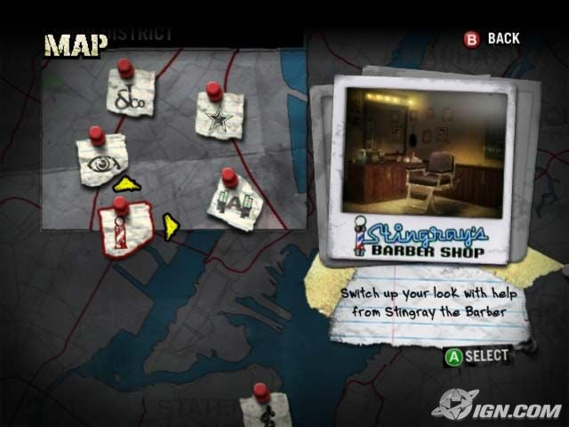

# LALAMOG — Tinder-Style Fight Club Portfolio Project

Updated: 2026-11-02 (Asia/Manila).
Purpose: share this file with another AI to analyze the product, architecture and modules, then propose an implementation-ready DESIGN.md.
Implementation checkpoint (2026-11-02): the React UI foundation is now implemented; see [frontend design](features/FRONTEND_DESIGN.md). Shared paper assets/clean controls, dossier gestures/match dialog, 1–5 style selection, auth/profile/inbox/chat/fight styling and exact-pair arrangement are in source. Production build and nine deterministic fixture browser cases passed. Real SQL/live SignalR/avatar/waiver/persistence suites were not rerun. Public results/titles are demo-only on `/preview`; `/map` now shows private participant venues; public map publication remains unimplemented (later maps follow-up).
Authority: the owner's clarified concept below supersedes the earlier training/sparring-product framing. Existing source and older documentation still reflect that earlier implementation; distinguish current code from the new target.

## 1. Assignment and project identity

Act as a product designer, interaction designer and frontend architect. Produce a cohesive proposed DESIGN.md using this brief.

**LALAMOG is a fun personal/portfolio project inspired by Tinder and the Fight Club movie.** The owner wants an entertaining self-project to build, experiment with and demonstrate. It is not intended for production rollout or public deployment. Do not turn it into a commercial fitness platform, coaching service, training-session app or professional sports system.

The owner explicitly wants **Tinder-like swiping**. Improve the card-stack interaction, gestures, transitions and match moment; do not replace swiping with a directory as the primary experience. The current swipe UI feels bad to the owner; changing colors alone is not enough.

The intended audience includes people with training/experience and beginners who are bored and looking for a fun Fight Club-style experience. Do not redefine their motivation as seeking structured sparring practice or sports coaching.

The desired mood is playful, social, cheeky and memorable. Fight Club is an inspiration for the concept; the map reference suggests a game-like map with pins, notes and a selected-location preview. Propose a specific visual system without sacrificing readability.

### Latest owner direction: dense fighter dossiers (2026-11-02)

The first generated samples were too flat, sparse and dominated by a large portrait. The target is now a visibly crumpled, creased and worn-paper environment with calmer paper zones for text, compact fighter portraits, stacked fighting-style icons, labeled green W/L/D meters and identity/title tags. Discover must feel like a video-game fighter dossier while preserving Tinder-style decisions. Details: [DESIGN.md](DESIGN.md), sections 4, 6 and 7.

Exactly five categories: **Streetfighting, Kickboxing, Submission (BJJ), Wrestling, Martial Artist**. A fighter may select multiple styles (1–5 distinct selections), including two or more; the existing single `fightingStyle` string needs a compatible target migration. Add matched icons and labels for each; React DOM/local SVG assets are appropriate.

Core styles, record and primary tag stay visible. Desktop hover/focus can reveal extra fight intel; mobile requires a tap equivalent. Define confirmed public W/L/D counts, denominator and no-record states rather than inventing power/health statistics. Add tags such as New player in town, Early member, Weekly fighter, self-declared Professional fighter, and Verified fighter only with explicit review scope (seeded mockups say Demo verification). Early member is a cohort label, not a paid subscription. Optional “#45 in Rizal” needs a defined locality/window/eligible pool/calculation or an explicit demo label. This targeted local-rank idea supersedes the earlier blanket exclusion of ranking; Elo, betting and prizes remain outside scope.

All added record, badge, review, multi-style and ranking fields remain target work or clearly labeled seeded examples, not existing API capabilities. The primary swipe loop and private/published boundaries remain unchanged.

Latest record-layout request (2026-11-02): use **one combined wins/losses/draws bar**, green/red/ochre with labeled counts and shared denominator. Beneath it show height in cm, weight in kg and opponent-rated 1–5 stars with numeric average/count and green score/red remainder meter. Unknown values stay unavailable, never inferred or fabricated. The preview demonstrates fictional 178 cm / 76 kg / 4 of 5 from 8 opponent reviews. Live measurements, review submission and aggregation need new APIs; target only actual opponents of completed Fights, one review per reviewer/Fight, no self-rating. See DESIGN.md section 6.

Latest typography/identity request (2026-11-02): locally bundle Old Newspaper Types for the brand/highlighted headings and red **unique fighter name**. Remove “Fighter dossier” label; medium black **alias** beneath is chosen by the user and may repeat. Existing `nickname` becomes the alias; separate `fighterName` is case-insensitively unique, selectable at signup/profile edit. Data-preserving migration gives existing profiles generated unique names without changing nicknames. Use five consistent style colors: Streetfighting/Brawler grey, Kickboxing green, Martial Artist violet, Wrestling blue, BJJ/Submission red. Exact tokens/source notice are in DESIGN.md and frontend assets. No runtime texture filters added.

### Implementation agreement: reusable textures, clean controls (2026-11-02)

The owner approved the textured direction but wants a straightforward, maintainable React/CSS build. Use **one optimized local crumpled-paper background image**, optionally one shared subtle panel-grain image, cream CSS panels, **clean SVG icons**, ordinary solid-color CSS buttons/tags and CSS record bars. Centralize colors, texture references and opacity in shared styles/components. Keep all labels/headings as real readable HTML text.

The generated previews overstate the wear on individual elements. Scratched buttons, textured icon glyphs, unique torn edges, distressed live text and runtime crumple/noise/displacement filters are not required. Optional decorative edges or one shared faint overlay can be added after the functional UI; they must not become a prerequisite for delivery. The backdrop supplies most of the atmosphere. This agreement takes precedence over those incidental mockup effects while retaining the dense fighter-dossier layout, style stacks, green record meters and tags.

React handles structure/state/gestures; CSS plus reusable static texture assets handles appearance. Do not bake a generated full UI screenshot into the app or create a separate image for every button. Solid-color fallback must remain usable when texture is unavailable/disabled. See DESIGN.md section 4 for the implementation contract and section 16 for phases. The UI implementation now bundles one original paper image, a fictional preview-only portrait, original clean SVG icons and local licensed fonts; asset provenance is in the frontend assets folder.

**No payment endpoints, checkout, subscriptions, betting, prize-money system, monetization, paid-map requirement or production deployment work.** The project will not be publicized. Local demo data and Azurite should support the portfolio flow without an Azure subscription.

Use fictional profiles, seeded locations and sample/staged clips for a complete portfolio demonstration. “Public map” means a viewer-facing surface inside the demo app, not an instruction to publish the application on the internet.

Your output is a design proposal, not code or a claim that the target features already work. Clearly label implemented behavior, required target features and optional ideas.

## 2. Core product loop

```text
Sign in / create profile
  -> Tinder-style card stack: left = pass, right = like
  -> mutual likes create a MATCH
  -> the pair gets its own private CONVERSATION
  -> press "Start the Match" inside that conversation
  -> choose a place from the public map:
       select a manually curated HOTSPOT
       OR drop/select a custom location pin
  -> set date and time; create a FIGHT for the matched pair
  -> record winner/loser or draw after completion
  -> upload a fight video / pre-edited montage
  -> publish the completed fight's video and result at its map location
  -> viewers click the location pin
  -> see a list of fights there, select one, watch and see the result
  -> return to Discover and continue swiping
```

A pair can return to the same conversation and arrange another fight. A location can accumulate fight history from different pairs over time.

## 3. Match versus Fight versus Location

| Term | Meaning |
| --- | --- |
| Swipe | A person's like/pass decision on another profile |
| Match | The persistent connection created by reciprocal likes |
| Conversation | The private message thread belonging to that matched pair |
| Fight | One occasion under that Match, with a place, date/time, state, result and media |
| Hotspot | A manually added/curated demo place, such as a gym or public parking area |
| Custom spot | A place selected/dropped on the map rather than a pre-created hotspot |
| Result | A winner/loser, draw, or explicitly unrecorded/unresolved outcome |
| Public map | A demo viewer surface for locations and published fight history/videos |

```text
Two users -> one mutual Match
               -> one private conversation
               -> MANY Fights over time
                    -> each has one location/date-time
                    -> each can have a result and uploaded video/montage

One Location -> MANY Fights from one or many matched pairs
               -> selected pin opens that location's fight history
```

**Yes: one match can have many fights.** A fight does not create a duplicate swipe match or an unrelated conversation.

The requested conversation CTA is **Start the Match**. It opens the fight-arrangement flow for the current pair; it does not immediately mark a fight underway. If proposing Start a Fight as clearer copy, present it as a label alternative without changing the requested flow.

Current SQL already allows multiple historical fights per Match but only one unfinished fight at a time. Keep that as the initial assumption unless the owner changes it; many fights over time does not require simultaneous unfinished fights.

## 4. Target modules

| Module | Required experience |
| --- | --- |
| Auth / profile | Account, recognizable profile/avatar, bio, style/experience and basic location |
| Discover | Tinder-like deck, gestures, pass/like buttons, pending/error recovery, mutual-match reveal |
| Matches / inbox | Find and reopen each pair's private conversation |
| Conversation | Text chat, Start the Match CTA, current fight card, previous fights, result/media actions |
| Location picker | Map browsing, nearby/manual location, custom pin, curated hotspot, confirm spot |
| Fight details | Participants, venue, local date/time, lifecycle, outcome and media state |
| Results | Winner/loser/draw, unresolved state, simple confirmation/correction rules |
| Video | Upload preview/progress/retry; Azurite-backed storage; playback and publication |
| Public map | Pin -> location fight list -> selected montage/result -> back to map or swiping |
| Hotspot maintenance | Manually add/edit locations through seeds or a small protected view; no enterprise admin portal |

Propose coherent mobile navigation with Discover, conversations and map easy to reach, plus a desktop layout. Current navigation labels/routes may change.

## 5. Public map — exact required behavior

### Location pins and fight history

A content pin represents a **location**, not a person's live position. Multiple fights at that location belong in its fight list rather than indistinguishable overlapping pins.

Using the owner's illustrative address:

```text
Barangay ABC, Block 1, Lot 38
  Fight 1: A vs B — A won — date/time — video montage
  Fight 2: C vs D — draw — date/time — video montage
  Fight 3: A vs B — B won — later date/time — video montage
```

This is illustrative demo content, not a real address or existing record. Use a stable location identity and stored coordinates. Do not group unrelated places just because address strings match. Nearby distinct spots may remain separate; clustering at zoomed-out scales is a presentation choice.

Required interaction:

1. Open the public map; pan, zoom and explore locations.
2. Completed fights with published content appear at their recorded location.
3. Click a pin -> open a location popup/modal or detail panel.
4. Show the place label/address and **a list of fights that occurred there**; newest-first is a reasonable proposed default.
5. Each list item includes participants, occurrence date/time, result, and a video poster/thumbnail when available.
6. Select a fight -> show its result and playable uploaded video/montage.
7. Back returns to that location's list; close returns to the map with center/zoom preserved.
8. Return to Discover to continue swiping, preserving the current deck position where feasible.

**The selected pin must lead to fight history and videos, not only a generic place card.**

### Owner-provided visual reference



The image shows a map with pinned notes and a larger selected-item preview on the right. Translate that into selectable location markers and a fight-history/video panel. On mobile, consider an accessible bottom sheet or full-screen panel; desktop can use a side panel/modal.

This is a reference for interaction and mood, not an app screenshot or a request to copy the game's assets, logos or exact controls. The text specification is self-contained if the image is not attached; share the image too when helpful.

### Hotspots, custom pins and visibility

- Hotspots are manually added places, such as gyms or public parking areas, available during place selection even when no fights occurred there yet.
- A custom spot comes from selecting/dropping a point and entering its place/address label. The picker is not limited to pre-created hotspots.
- A hotspot can also contain completed fight history. Distinguish available hotspot markers from locations with published fight videos through marker variants, layers or a toggle.
- A nearby view can use the selected map area/center. Device location is an explicit optional action with a manual fallback.
- Draft/upcoming arrangements remain private to the pair and must not appear as already-occurred public fights.
- Published coordinates represent the chosen fight venue. Do not expose profile home/live-GPS position, private chat or emergency contacts through map responses.
- Selecting anywhere is a UI/data capability; it does not label every map point as an approved or verified venue.
- Public means visible to demo viewers beyond the pair. Anonymous access versus sign-in is an open design decision, not a deployment requirement.

## 6. Fights and outcomes

Each target Fight belongs to a Match and includes the two participants, location, date/time, lifecycle, result state and media/publication state.

Distinguish arranging from starting. A possible lifecycle is arranging -> scheduled -> in progress -> completed, plus cancellation. These extra states are **proposed**, not current API support.

Result entry must support:

- Participant A won; Participant B lost.
- Participant B won; Participant A lost.
- Draw.
- Unrecorded/unresolved, so a completed fight never gets a fabricated winner.

Define a simple submission/agreement/correction flow: who submits, whether the other person confirms, and how disagreement is shown. A two-person pending/confirmed result is a reasonable proposal; a formal tournament/dispute bureaucracy is not needed for the initial portfolio.

Show the same result in conversation history, fight details and the map video item. Canceled is not a win/loss. Do not add Elo, betting or prizes. Optional scoped local demo rank and public record tags follow the latest direction above, without turning this into a tournament platform.

Current acknowledgement/emergency-contact forms come from the earlier session implementation. Accurately describe what is retained, renamed or simplified during migration; do not organize the new product around coaching or training-session forms or pretend old code has already changed.

## 7. Video / montage — Azure-compatible, Azurite locally

Users upload a fight clip or pre-edited montage linked to a Fight. Published video and result are shown in the corresponding map location's history.

- Use **Azurite**, the Azure Blob Storage emulator, for local portfolio media storage. An Azure subscription/cloud deployment is not required.
- Target an Azure Blob-compatible adapter. Actual Azure cloud provisioning is optional configuration, not required scope or a paid dependency.
- Store files/posters in blob storage; store ownership, fight linkage, media metadata, result, location and publication state in SQL.
- Show file selection/preview, uploading/progress, failed/retry, uploaded and playback states.
- Uploading is fight-scoped; viewers do not attach unrelated videos directly to arbitrary map pins.
- A user-uploaded pre-edited montage is enough initially. Automatic editing, transcoding, generated highlights or a processing worker are not assumed requirements.
- Propose practical initial format/size/duration limits as new implementation decisions. Existing image limits do not mean video support exists.
- Define draft/private versus published media and how participant approval/withdrawal works. Publishing shares the selected clip/result/venue, not the pair's private messages or contacts.
- Seeded or staged sample media can demonstrate this whole flow; a real event is not required.

Multiple videos per fight and generated thumbnails can be optional extensions. Do not add production media infrastructure or payment scope.

## 8. Implemented today versus the requested target

The backend retains the earlier scheduling contracts while the React UI now reflects the clarified portfolio concept. This is a UI redesign over those contracts; results/video/public maps still need backend implementation; basic private pins/area selection are implemented.

| Area | Implemented today | Target work still needed |
| --- | --- | --- |
| Auth/profile | New paper forms/copy, profile/avatar, 1–5 styles via compatible string adapter, experience/text location | Future collection DTO if needed; server-computed record/tag fields |
| Discover | Responsive dossier deck, drag/buttons/keyboard, pending/error recovery, mutual-match dialog; up to 50 candidates sorted by nickname/ID | Public record/tag data; optional richer exit transitions/filters |
| Matching | Reciprocal likes create one persistent match; match list; dialog opens the pair's conversation | No new matching persistence required |
| Conversation | Private REST/SignalR text chat, Start the Match CTA, current/previous Fight context, exact-pair arrangement links | Result/video actions and richer fight cards |
| Existing fights/sessions | Manual place/address, optional private pin/PSGC area, date/time, acknowledgements/contacts, cancel/complete; one unfinished fight per Match | Map-selected location/hotspots; result flow; target lifecycle if chosen |
| Media | Local validated JPEG/PNG/WebP avatar upload | Blob/Azurite adapter; video metadata/upload/publication/playback |
| Public map | Not implemented | Locations/coordinates, hotspot data, pin history and video/result panels |
| Fight outcome | Completion has no win/loss/draw fields | Result persistence, agreement and display |
| Redis/RabbitMQ | Containers provisioned, no application workflow | No need to add work solely to use these containers |

Current routes: `/` Discover; `/matches`; `/matches/:matchId`; `/sessions` (optional `matchId` query); `/profile`; `/preview` (fictional UI-only); `/map` (unavailable state). Working public map/fight-detail/hotspot services/routes remain target work.

Current discovery supports drag intent/cancel/thresholds, explicit buttons/keyboard, two decorative back sheets, profile/intel dialog and direct mutual-match conversation action. It removes a candidate only after successful server acknowledgment and restores failures. Undo/pass history/filter/search remain unimplemented. Product empty-state copy has replaced developer testing instructions.

Current UI uses one crumpled-paper background with calmer reading panels, brick-red controls, compact portrait/record dossiers, clean style icons, mobile bottom navigation and desktop header navigation. Browser fixture checks and screenshots covered 360/375/390 px and desktop; actual device, comprehensive accessibility/zoom and live backend coverage remain separate.

## 9. Architecture and implementation fit

```text
React DOM / TypeScript / React Router / Vite (:5173)
  -> shared api.ts HTTP client: cookies, session and CSRF
  -> ASP.NET Core .NET 10 API (:5080), one project
       Controllers -> service interfaces / Services
                    -> domain Repositories -> EF Core -> SQL Server
                    -> IFileStorage -> current local avatar storage
  -> authenticated SignalR conversation notifications

Target additions, not implemented:
  Map UI -> locations/hotspots API -> SQL location identities/coordinates
  Conversation -> fight arrangement/history under existing Match
  Fight result flow -> persisted outcome/agreement
  Video flow -> Blob-compatible adapter -> local Azurite
  Public map read API -> published location/fight/result/video projection
```

Keep the existing foundation:

- Browser app, mobile-first DOM/CSS; no Expo/React Native rewrite.
- One horizontal N-tier API with Controllers, Services, Repositories, Interfaces and DTOs.
- Microsoft SQL Server/EF Core; C# business rules, SQL structural constraints/transactions.
- Native AppUser with HttpOnly cookie authentication and participant authorization; current CSRF enforcement gap is recorded in the authentication guide.
- SQL is authoritative for matches/messages/fights and proposed results/media ownership. SignalR is a notification/recovery signal, not history storage.
- Preserve existing SQL data, avatars, cookie keys, migration history, match uniqueness and canonical pair ordering.
- Public map reads use explicit public DTOs, separate from private conversation/contact/arrangement responses.

Suggested target data concepts, not committed schema: Match -> many Fights; Location -> many Fights; Fight -> Result fields/record; Fight -> Media metadata/storage keys/publication state. A hotspot can be a curated flag/source on Location rather than a duplicate location table. Choose a simple model after inspecting current source.

Available public profile fields: userId, nickname, bio, fightingStyle, experienceLevel (Beginner/Intermediate/Experienced), text location/availability, avatarUrl. No actual distance, verified badge, weight class or compatibility score is supplied. New fields/seeded mock data must be explicitly identified.

Requested additions: a distinct `fightingStyles` collection, public confirmed W/L/D aggregates, earned/self-declared/reviewed tag provenance, and optional scoped local demo rank. These require new contracts/data; existing fields do not supply them. Preserve old style values during migration and do not derive verification or physical ability from portraits.
Current compatibility implementation: UI style stacks serialize supported keys `streetfighting|kickboxing|bjj|wrestling|martial` (47 characters maximum) into the existing `fightingStyle` field. This persists through existing APIs without a schema change. Unknown legacy values remain until explicitly replaced. A dedicated collection DTO/schema remains future work; public records/tags/rank still require new data.

Current API surface:

- `/api/auth/*`, `/api/profiles/me`, `/api/profiles/me/avatar`.
- GET `/api/profiles/discover`.
- POST `/api/matches/swipes`: targetId and like/pass; returns matched/matchId.
- GET `/api/matches`.
- GET/POST `/api/matches/{id}/messages`, before/after cursors for history.
- `/api/fights`, `/api/fights/{id}`, confirm/cancel/complete actions.
- `/api/media/{key}` for current images; `/hubs/messages` for live chat signals.

Coordinates, location/hotspot persistence, results, video upload/publication and public map history require new contracts. Current image endpoints do not automatically support video. Propose small map-location/count and selected-location fight-list read contracts, with public participant names/time/result/playable-media metadata. Keep credentials, account emails, private messages and contacts out of these responses.

Local development stays simple: Compose in infrastructure, `dotnet build` / `dotnet run` in backend, `npm run dev` in frontend. Appsettings plus private infrastructure/.env supply settings. SQL/RabbitMQ/Redis exist; **Azurite still needs adding**. Use no-payment map/data options with attribution and manual/seeded demo fallback. Do not require a card, paid provider account, paid cloud resources or public launch.

## 10. Source map for another AI with repository access

```text
ACTIVE_frontend_lalamog/src/
  App.tsx           auth/navigation/Discover/shared Avatar
  ProfileEditor.tsx profile/avatar
  Matches.tsx       pair list and private conversation
  Fights.tsx        current session/fight lifecycle UI
  api.ts            HTTP/cookies/CSRF
  types.ts          current contracts
  styles.css        current responsive styling

ACTIVE_backend_lalamog/
  Program.cs        configuration/DI/auth/CSRF/startup
  Controllers/ Services/ Repositories/ Interfaces/ DTOs/ Models/
  Data/ Migrations/ current SQL model and migration history
  Infrastructure/   configuration/initialization/errors
  appsettings*.json non-secret defaults
  solution/Lalamog.slnx
  docs/             current architecture/contracts/feature memory

infrastructure/     Compose/private .env; Azurite pending
scripts/            optional helpers/shared ignore rules
tests/              existing backend tests
LEGACY_*/           preserved references, not active implementation
```

Read active source before file-specific implementation advice. With only this brief, do not claim to have opened the app or inspected runtime/user data. When older docs disagree, use the owner's revised concept here as the target and report the implementation gap. Do not label requested features complete just because this document describes them.

## 11. Required contents of the proposed DESIGN.md

1. **Identity/scope:** fun personal portfolio, Tinder-style Fight Club concept; current implementation versus required target; no training-service framing or monetization/production scope.
2. **Core loop/terminology:** swipe -> Match/private conversation -> arrange Fight -> result/video -> location map history -> swipe again; one Match can have many Fights.
3. **Swipe interaction:** card hierarchy, deck, left/right gestures, thresholds/cancel, scroll handling, explicit buttons/keyboard alternatives, pending/error/retry, match reveal with Open conversation / Keep swiping, and reduced motion.
4. **Information architecture:** navigation and proposed routes; smooth return among Discover, inbox/conversation, fight flow and map, with useful state preservation.
5. **Visual direction:** specific playful Fight Club-inspired palette/tokens, type, spacing, surfaces, photo/icon/motion rules; interpret the reference without copying game assets.
6. **Conversation:** contextual Start the Match CTA, current fight card, previous fight history, time/place/result/media actions; avoid making users select the same partner again in an unrelated form.
7. **Location selection:** custom pin versus curated hotspot, nearby/manual browsing, confirmation, place labels, permission/fallback behavior.
8. **Fights/results:** proposed lifecycle, date/time, current one-unfinished-fight assumption, winner/loser/draw/unresolved, submission/confirmation/correction and repeated fights in one conversation.
9. **Video:** pre-edited montage upload, progress/error/retry, local Azurite/Blob-compatible storage, poster/playback, private/published state and withdrawal; optional processing features labeled separately.
10. **Public map:** hotspot/content marker differences, clustering, pin -> location fight list -> montage/result detail, back/close, mobile bottom sheet/desktop panel, loading/empty/error/pagination and map-position preservation.
11. **Responsive components/wireframes:** concrete layouts for Discover, inbox/chat, location picker, fight/result/upload, map panels, auth/profile at 360/375/390 px and desktop; focus, contrast, touch targets, keyboard and video controls.
12. **State/microcopy matrix:** playful clear copy for discovery/match/chat/fight/map/upload/result states; remove developer testing instructions and old training/coaching terminology from proposed UI.
13. **Data/API plan:** existing match/chat reuse; new locations/coordinates/hotspots, results, media/publication, public projections, storage and migration dependencies explicitly marked.
14. **Achievable delivery phases:** swipe/chat polish first; then location/fight history; then result/video/Azurite; then public map playback/polish, using seeded end-to-end demo content. Do not expand into an enterprise platform.
15. **Acceptance/open decisions:** practical demo scenarios plus consequential choices such as result confirmation, publication approval, media limits and guest map access. No invented implementation/test claims.

## 12. Portfolio demo acceptance scenarios

- Two demo accounts swipe right, match and open the same private conversation.
- Start the Match inside that chat arranges a fight for that exact pair.
- Choose a curated hotspot OR a custom map pin, then date/time.
- Two or more historical fights exist under the same Match/conversation, with separate places/times/results/media.
- Winner/loser and draw display correctly; unrecorded/canceled fights do not become fake wins.
- A sample video/montage uploads through Azurite and plays back.
- A completed published fight appears at its recorded map location.
- Two fights at one Location appear in that pin's fight list; selecting each shows its own montage/result.
- A hotspot with no history does not pretend fights already happened there.
- Back/close preserves map state; returning to Discover resumes swiping naturally.
- Slow/failed swipes/uploads, empty results and unavailable videos have understandable recovery states.
- Public/demo viewers cannot read private messages, contacts or unpublished arrangements.
- The entire demonstration works without payment endpoints, real-money features, paid cloud provisioning or public deployment.

Keep the design centered on this fun portfolio loop and existing stack. Do not redefine it as a training-session app or production sports business.
