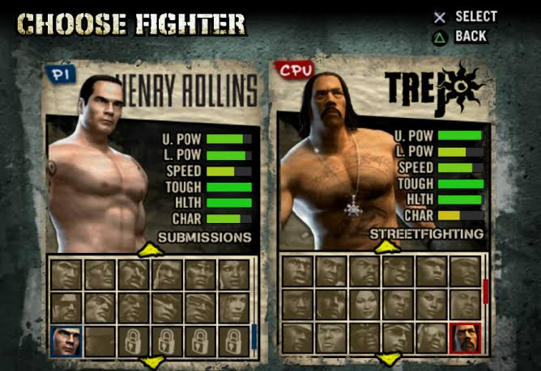
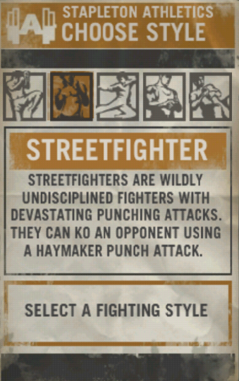

# LALAMOG — Design system and interaction direction

Owner revision 2026-11-08, implemented for `/map`: the map is the viewport's
main surface between header and navigation, with no vertical page scrolling.
Title/legend, Filters, About and browse actions float on it. Lists, filters and
pin details use accessible native dialogs; long popup content may scroll.
Keep the map mounted under popups and preserve visible attribution/zoom, manual
list alternatives and privacy. This supersedes the inline map/list and proposed
map bottom-sheet geometry below. Current scope/checks: [maps](features/MAPS_AND_AREAS.md#full-screen-map-presentation).

Owner follow-up 2026-11-08: **every map popup uses the swipe police notebook
skin**—spiral binding, warm ruled paper/red margin, red newspaper headings,
typed labels and taped Polaroid venue photos. Preserve native dialog behavior
and internal scrolling, with a sticky close header. Keep other modules' popups
unchanged. Source/recovery/checks: [map notebook dialogs](features/MAPS_AND_AREAS.md#notebook-styling-for-every-map-popup).

Updated: 2026-11-08 (Asia/Manila). Status: **swipe notebook and viewport public-gym/private-pin map implemented; competitive results/video targets remain proposed**.

Owner revision 2026-11-07, implemented for **swipe/Discover only**: a police
field-notebook presentation supersedes the flat dossier treatment on this
module. Keep the portrait left in a taped Polaroid frame, light ruled details
right, spiral binding above, and full-width field notes beneath. Rules, red
margins, tape and binding use CSS; typed metadata/aliases/notes use the local
system Courier stack. Red newspaper names, style colors and clear Like/Pass
language remain. Stack below 340px for readability. Other routes keep the shared
design. Current implementation/checks: [frontend design](features/FRONTEND_DESIGN.md).
Public gym maps/history now exist; older full map/result/video proposals below
remain target/historical context, with current scope in [gym booking](features/GYM_BOOKING.md).

Implementation checkpoint: [frontend design guide](features/FRONTEND_DESIGN.md). Shared paper/CSS/icons, mobile dossier gestures, match reveal, style stacks, auth/profile/inbox/chat/fight restyling and contextual arrangements now exist. Build and nine fixture browser cases passed; live SQL workflows were not rerun. `/preview` contains explicitly fictional records/titles; real accounts show unavailable record slots. `/map` is an honest empty state. A future collection DTO is not required for the current style UI: one adapter serializes five supported keys into the existing 50-character field without schema changes.

Product authority: [DESIGN_BRIEF.md](DESIGN_BRIEF.md), plus the owner's latest direction: a textured, information-rich fighter-selection experience with stacked styles, green record bars and identity tags. Exactly five style categories; a fighter can select several. This revision supersedes the initial single-style, oversized-photo mockups. Older training-service language describes the existing code, not the target product.

**Latest implementation agreement:** strong texture belongs primarily to a reusable background image; panels may have subtle shared grain. Icons, buttons and text stay clean. The heavily distressed generated previews communicate mood and layout, not a requirement to reproduce every scratch, torn edge or worn glyph. The maintainable implementation rules in section 4 take precedence over incidental visual effects in those images.

## 1. The direction

**A fighter dossier pulled from a crumpled street noticeboard.** A creased-paper background image over a charcoal underlayer, calmer cream panels, compact fighter portraits, clean style emblems, green record meters and stamp-like rectangular identity tags. Big condensed headings, black rules, red selections and yellow direction marks keep the composition readable. The same small set of assets and shared components appears on every screen.

LALAMOG is a playful personal portfolio project: meet fictional fighters, swipe, match, talk, arrange a fight, record its outcome, upload a staged montage, and discover its history on a map. It should feel like moving through a coherent PS2-era fight-game menu, adapted to a fast mobile browser app.

The repeated structure stays simple even when the card carries more information: title, portrait/record, styles, identity tags and actions. The portrait shares space with the dossier. Strong material texture and useful information must both be evident at first glance; avoid another giant photo above an otherwise empty card.

### Reference translation

| Owner's reference | What to borrow | LALAMOG use |
| --- | --- | --- |
| Choose fighter | Portrait, paper frame, oversized name, compact facts | One swipeable fighter dossier |
| High scores | Tight rows, strong column headings, aligned information | Fight history and an optional, explicitly scoped local demo rank |
| Choose match type | Selection changes one adjacent explanation | Fight arrangement steps and style choice |
| Select user ID | List on one side, selected profile on the other | Desktop inbox and conversation |
| Map | Pinned notes and a larger selected-place preview | Location pin → fight list → montage and result |
| Choose style | Five consistent pictograms, one selected, one description | Profile style selector |

The attached screenshots are the primary visual evidence. Supplemental research: [PSP screenshot catalog](https://www.mobygames.com/game/34726/def-jam-fight-for-ny-the-takeover/screenshots/), [GameSpot's PSP interface comparison](https://www.gamespot.com/articles/e3-06-def-jam-fight-for-new-york-the-takeover-hands-on/1100-6150580/), and [GameSpot's style-selection description](https://www.gamespot.com/articles/def-jam-fight-for-ny-the-takeover-hands-on/1100-6153422/). The swipe design below is our adaptation, not a claim that Def Jam had a swipe interface.

Use original LALAMOG artwork, portraits, textures and pictograms. Reference screenshots belong in design documentation only. Do not extract game logos, character renders, menu artwork, sounds or controller symbols into the app.

### Keep the system small

- A visibly creased-paper environment, a calmer paper reading surface, one selection treatment.
- One main action per task; consistent secondary actions.
- Portrait, stacked style emblems, W/L/D record, earned/demo titles and factual metadata form one fighter dossier.
- Short uppercase headings; normal readable sentences for instructions and messages.
- Square corners, solid borders and compact lists; folds, wrinkles and stains come mainly from the backdrop artwork.

Green segmented meters and compact status tags are intentional game-like elements. Avoid neon glow, glass panels, rainbow style colors, dozens of equal-priority badges, distressed body text and animated background noise. Meters visualize record/activity with defined data; health, power and speed would require a separate clearly fictional mechanic and are not asserted about real users. Do not import game assets, cash, shops or paid progression.

## 2. Scope and honest implementation status

| Status | Capability |
| --- | --- |
| Existing baseline | Cookie sign-in, profile/avatar, button-based like/pass, reciprocal Match, private text conversation, existing fight scheduling/confirmation/cancel/complete |
| Required target | Textured dossier deck and match reveal; multiple selections from five style categories with icons; W/L/D meters and identity tags; contextual fight arrangement; locations/hotspots; repeated-fight history; outcomes; Azurite video upload/publication; map fight-history playback |
| Optional later | Local demo rank after its computation exists; undo with a real backend contract, style filters, multiple clips, generated posters, extra lifecycle states |

Existing fights use `scheduled`, `confirmed`, `canceled`, `completed`. Gesture deck and restyled core screens are now implemented; fixture/browser verification limits are in the implementation checkpoint. Outcome, public map and video pipelines remain unimplemented. The remaining sections describe the full target; use the checkpoint/feature guide to distinguish delivered UI from future contracts.

No payments, betting, prizes, subscriptions, Elo, coaching platform, production rollout or public internet deployment. Public map means the demo's shared viewer surface. Use fictional profiles, seeded places and staged clips. Redis and RabbitMQ need no invented workflow merely to appear in the architecture.

## 3. Product language and core loop

```text
Create profile → Discover → swipe left PASS / right LIKE
  → reciprocal likes create one MATCH
  → open that pair's private CONVERSATION
  → Start the Match → choose spot → set date/time → arrange FIGHT
  → complete → record result → attach montage → approve publication
  → MAP → location pin → fights here → video + result
  → back to Discover
```

**Match** is the persistent connection. **Fight** is one occasion under it. One Match has one conversation and many historical Fights. One Location can hold many Fights from different pairs. Initial constraint: only one unfinished Fight per Match.

Keep the requested CTA **Start the Match**. Beneath it, say “Choose a place and time with [nickname].” It opens arrangement; it does not immediately start or complete a Fight. Use Like and Pass for discovery, not Challenge/Accept: a right swipe is interest, not an arranged fight.

Voice: cheeky in headings, precise in decisions. “Found your match.” “Pick your spot.” “Another round?” Results, privacy, dates and failures use plain language. No forced threats or insults. A beginner remains a valid profile, not a mocked or locked character.

## 4. Visual tokens

### Color

| Token | Value | Role |
| --- | --- | --- |
| `wall` | `#121714` | Page environment |
| `wall-raised` | `#202A27` | Dark header/navigation and map surroundings |
| `paper` | `#E8DFC6` | Main panels and list rows |
| `paper-light` | `#F8F0DB` | Form fields, lifted cards and video frames |
| `ink` | `#191B18` | Text and borders on paper |
| `muted-on-paper` | `#56584C` | Secondary text on paper |
| `muted-on-wall` | `#BFB69E` | Secondary text on dark backgrounds |
| `selection` | `#8F2725` | Primary action, active row, Like stamp |
| `selection-text` | `#F8F0DB` | Text on red |
| `signal` | `#D9B84A` | Focus ring and small directional marks |
| `success` | `#45683D` | Confirmed status on paper, paired with text/icon |
| `record-track` | `#252B22` | Dark segmented-meter track |
| `record-green` | `#7BCB35` | Wins/activity meter fill; dark text only |
| `record-lime` | `#AEDC56` | Secondary meter accent |
| `paper-shadow` | `#B1A184` | Folds, pressure marks and distressed outer edges |

Primary pairings: ink/paper, paper-light/wall, paper-light/selection. Use selection/ink as a boundary only with an additional light edge where needed. Yellow and bright green carry dark text; keep cream meter labels beside the dark tracks, not on bright fill. Use dark green `success` for text on paper. Errors use a red icon, explicit message and ink body copy inside a paper notice. State never relies on color alone.

### Typography

Use locally bundled **Old Newspaper Types by Manfred Klein** for LALAMOG, fighter names and highlighted headings. The owner's [DaFont page](https://www.dafont.com/oldnewspapertypes.font) lists it as “100% Free”; the archive contains only the TTF, and the local asset notice preserves author/source/classification. Use **Barlow** for body/forms/aliases and **Barlow Condensed** for dense stat/style labels. The font itself supplies its worn print shape; no runtime text mask/filter or custom distressed glyph is needed. Keep highlighted names sized to wrap safely on narrow screens, and body text clean/readable.

Identity header: remove the “Fighter dossier” eyebrow. Display the **unique fighter name in red using Old Newspaper Types**, with the **non-unique alias beneath in medium black Barlow** (e.g. Miko / “Crow”, Jae / “Grim Reaper”). One shared `fighterName()` fallback keeps old API clients readable; `nickname` remains the alias for compatibility. Server-normalized unique fighter names and optional legacy-client updates preserve that distinction. Registration and profile editing expose both fields; aliases can repeat.

| Role | Mobile / desktop | Treatment |
| --- | --- | --- |
| Screen title | 30/34 px / 44/49 px | Old Newspaper Types, uppercase, slightly tight tracking |
| Fighter name | 34/36 px / 46/49 px | Red Old Newspaper Types; wraps safely |
| Alias | 18/22 px | Black Barlow, medium/bold; non-unique nickname |
| Section heading | 22/25 px / 26/29 px | Old Newspaper Types |
| Button / row title | 16/20 px | 700; short labels may be uppercase |
| Body / form value | 16/24 px | 400–500, sentence case |
| Metadata | 14/20 px | 500; never distressed |

Use tabular numerals for dates, counts and progress. Avoid shrinking long names or translating every sentence into uppercase. Text zoom must work without clipping.

### Geometry and texture

- Spacing scale: 4, 8, 12, 16, 24, 32, 48 px. Mobile outer gutter 16 px; desktop 32 px.
- Panels: 2 px ink border, 0–2 px corner radius, 16 px padding mobile / 24 px desktop. A hard `4px 4px` dark shadow indicates an elevated sheet; no soft glow.
- Lists: continuous rows with 1 px dividers; avoid a separate floating card around every row.
- Three material layers: charcoal underlay, large warm-grey/cream crumpled-paper backdrop, then flatter cream dossier panels. Make broad fold ridges, compression wrinkles, uneven fibers, rubbed ink and edge stains visibly present in the backdrop, especially on desktop. Start background texture around 15–25% contrast/opacity and tune visually; do not mistake barely visible noise for crumpled paper. Reading zones use an opaque or ≥94% cream backing and about 3–5% fine grain. No fold shadow crosses small text or a face. Always provide solid-color fallbacks.
- Torn edges, tape and pinned corners may be baked into the single decorative backdrop; custom-shaped panel edges are optional later polish. V1 uses rectangular panels, inputs, buttons and messages with stable hit areas.
- Tilt: up to 1° on decorative photo backplates only. Text, forms, active cards and focus rings stay level; swipe rotation is the interaction exception.
- Icons: five matched bold monochrome style silhouettes in 40–48 px square emblems; common navigation/action icons at 24 px. See icon sourcing in section 7. Visible labels accompany styles and important actions.

### Maintainable React/CSS implementation contract

**Default: textured background, lightly textured panels, clean controls.** React supplies reusable components and interaction; ordinary CSS and a few static local images supply the material effect. There is no special React texture filter to build or maintain.

| Element | V1 implementation | Optional later polish |
| --- | --- | --- |
| Crumpled environment | One optimized local WebP/JPEG paper background with visible creases, shared through the app shell; charcoal/cream fallback colors | A second responsive crop only if needed |
| Paper panels | Cream CSS fill, border and shadow; optionally one shared small seamless grain image | A reusable decorative edge asset |
| Style/navigation icons | Clean SVG silhouettes/components with labels and plain square frames | None needed for the approved direction |
| Buttons and tags | Ordinary semantic controls/labels with solid CSS fills, borders and focus states | One shared, faint grain overlay, decorative and `pointer-events: none` |
| W/L/D meters | CSS track and percentage-width fill; segments via a shared CSS pattern | Brief fill transition respecting reduced motion |
| Typography | Real selectable HTML text with clean fonts | A single pre-made wordmark, never text baked into page screenshots |

Start with at most **two shared texture assets**: the crumpled backdrop and optional fine panel grain. Asset names/locations are proposed until supplied; keep them in the active frontend's local assets with provenance/license credits. Use CSS custom properties/shared classes so replacing a texture, reducing intensity or changing a color updates the whole app. `PaperPanel`, `ActionButton`, `StyleBadge` and `RecordPanel` reuse those classes; do not create a separate textured image for each component or state.

Use a background layer whose opacity/tint can change independently of content. Do not lower the opacity of the entire panel or blur/filter its children. Keep decorative layers behind controls; maintain text contrast and keyboard focus over every background crop. Allow image caching and normal responsive layout. If an image fails or has not yet been supplied, the solid-color version remains fully functional.

Unique scratches per button, distressed icons, live crumpling, per-component SVG noise/displacement filters, canvas/WebGL effects and hand-built torn-edge masks are **not required for v1**. A whole generated UI screenshot must never become the page background: generate/license only the decorative paper material, then build the actual layout, text and controls in React/CSS. Texture is a skin that can be removed without changing swipe, chat or form behavior.

### Portraits and imagery

Use fictional, consented demo portraits: documentary lighting, varied people, neutral urban/gym backdrops. Mild desaturation and warm paper framing unify images; preserve recognizable faces. Compact portraits share the upper card with record panels. Hover/tap detail may occupy the lower portrait area using an opaque inset; it never hides the face. Names, style labels and core records remain visible without hover. Missing avatar: a designed initial block, not a broken image or stock fighter render.

### Selection, focus and action hierarchy

Selected row: red fill, cream label, leading arrow/check, stable dimensions. Hover: slightly darker paper. Keyboard focus: 3 px yellow ring with 2 px dark offset; on paper the dark offset keeps it visible. Focus and selection are separate states.

Primary button: red/cream, rectangular, at least 48 px high. Secondary: cream/ink with a solid border. Destructive controls use explicit verbs and a confirmation only when discarding meaningful work. Disabled controls retain readable labels and explain the reason nearby. Loading labels keep button width stable.

## 5. Navigation and routes

Mobile bottom navigation: **Discover · Inbox · Map · Profile**, each icon plus label. Active item uses the same red selection band. Height 64 px plus device safe area; reserve that space in page content. Brand/header is compact, about 52 px. The back button returns to the originating context.

Desktop: the same four destinations in a compact header within a 1200 px content width. No dashboard sidebar full of extra modules. Discover centers a wider portrait/intel dossier; inbox and map use list/detail columns.

| Route | Target behavior |
| --- | --- |
| `/` | Discover; existing path |
| `/matches` | Inbox; existing path, proposed label |
| `/matches/:matchId` | Existing conversation context plus proposed fight cards/history |
| `/matches/:matchId/arrange` | Proposed place/time flow, partner inherited from Match |
| `/fights/:fightId` | Proposed details, result and media actions |
| `/map` | Proposed shared demo map |
| `/map/locations/:locationId` | Proposed location history; query can select `fightId` |
| `/profile` | Profile plus five-style selector; existing path |
| `/sessions` | Existing route retained or redirected to an appropriate history entry after migration; do not break old links |

Discover remembers current candidate/order and scroll while navigating in the same signed-in session; revalidate against server decisions on return. Clear cached private state on logout/account change. Map remembers center, zoom, layers, selected Location, list scroll and originating route. Fight detail opened from map returns to that location's list; opened from chat returns to chat. Private drafts are user-scoped; no credential storage in browser storage.

## 6. Discover: an information-rich fighter dossier you can swipe

The main view is **one person at a time**. A roster grid may inspire the framing; it must not replace the Tinder deck.

```text
LALAMOG                            Profile
DISCOVER / CHOOSE YOUR NEXT MATCH
┌──────── crumpled dossier ──────────┐
│ MIKO                      RIZAL   │
│ [Weekly fighter] [Early member]   │
├─────────────────┬────────────────┤
│                 │ PUBLIC RECORD  │
│    PORTRAIT     │ 8W : 2L : 1D    │
│                 │ [WWWWWWWWLLD]  │
│                 │ 178 cm · 76 kg │
│ [i Fight intel] │ ★★★★☆ · 4 / 5  │
├─────────────────┴────────────────┤
│ [fist]      [kick]     [grapple]  │
│ Streetfight Kickboxing BJJ        │
│ Intermediate · Available weekends│
│ Here for another round.          │
│ 11 recorded · Win rate 73%        │
│ [View profile & fight history]   │
└──────────────────────────────────┘
      [← PASS]          [LIKE →]
Discover        Inbox       Map    Profile
```

Illustrative seeded record above: 8 wins, 2 losses, 1 draw; all sample facts. Card order: name/location → main title and up to two supporting tags → portrait beside public-record meters → selected style emblems → experience/availability → short bio → history/detail link. More than three selected styles wrap to a second row rather than disappearing. All five remain inspectable. Do not overload the card with five independent stat boxes and a giant photo. Actual distance, weight, compatibility and physical skill scores are absent unless separately implemented.

At 390 px, the card is roughly 358 px wide; at 360 px, 328 px. Upper portrait/record split: about 56% / 44%, 180–220 px tall; labels/counts use at least 14 px. Name uses about 30 px, supporting labels 14–16 px. Short or zoomed viewports can stack portrait and record and scroll the dossier; controls remain reachable. Desktop deck may expand to 760–880 px, with a larger portrait left and record/style/intel column right. It still shows one candidate at a time. Two creased back sheets, offset 8/16 px, suggest the next dossiers without exposing unrelated actionable cards.

### Record bars that mean something

Always show **W / L / D counts above ONE combined horizontal bar**, ordered wins → losses → draws. Green = wins, brick red = losses, ochre = draws; color is paired with a labeled count/legend. All segments share `N = wins + losses + draws`; each segment width is that outcome / N. Never render three separate outcome meters or independently normalize their lengths. Unknown/zero records leave the single track empty, with explicit unavailable/no-record wording.

Below this bar show **height (cm), weight (kg), then opponent rating**. Height/weight are profile-supplied measurements when the API supports them, never inferred from a portrait. Opponent rating is a distinct 1–5 star average with numeric value (e.g. 4 / 5), review count and a green/red meter: green width `average / 5`, red remainder of the scale. The remainder does not represent negative-vote count. Unknown rating says “Not rated”, with neutral empty track; unknown measurements say “Not available”. Use the shared `RecordPanel` on both the dossier and intel dialog.

Current implementation shows fictional 178 cm, 76 kg, 4 / 5 from 8 opponent reviews only for the Miko design-preview fixture. Live profile DTOs do not yet supply measurements or rating aggregates, and no review-submission workflow is implemented. Target review rule: only the other participant of a completed Fight can rate that fighter; one review per reviewer/Fight, no self-rating, persisted score/count and explicit public visibility. This is an opponent’s review of their experience, not an objective combat-skill measurement; review editing/correction and aggregate updates require future server contracts.

Win rate is `wins / N`, rounded to a whole percent; draws remain in the denominator. New player: “No recorded fights yet”, zero counts and empty tracks; no invented 0% performance or full green bars. Pending, unresolved, canceled and unrecorded fights do not enter W/L/D; show their counts in detail if useful. Source: completed, confirmed-result Fights whose participants approved public visibility. Label the scope “Public Lalamog record”; this is not a career record. Result corrections/withdrawals must update the projection, including cached deck cards. Existing source does not yet provide these aggregates.

### Hover, tap and keyboard inspection

Core styles, record and main title are always visible. On desktop, pointer hover or keyboard focus on **Fight intel** opens a small opaque paper inset in the lower portrait region or beside it. It reveals recent public results, badge meanings and optional rank details without hiding the face. Hovered content must be dismissible, hoverable and remain visible while interacting; Escape dismisses it. On mobile, tap **Fight intel** to open the same content in a sheet. No required information depends on hover.

Dragging suspends hover effects and dismisses the transient inset. Buttons, badge explanations and links stop gesture initiation; a tap that opens intel never swipes. An expanded sheet has its own scroll; swipe gestures apply only to the deck when the sheet is closed. Use a short 120–180 ms paper-lift/inset reveal; reduced motion skips translation. The Like stamp, red selection frame and green record create the game feel without flashing meters or looping animations.

### Titles, tags and local rank

Treat these as discrete emblem-and-label product tags, not paragraphs: one main title, up to two compact supporting tags; **+N tags** reveals the remainder. Tooltip/tap detail gives criteria, issuer and scope. Separate achievement titles from self-description and verification.

| Tag/title | Proposed basis and meaning |
| --- | --- |
| New player in town | Account joined within 14 days; tooltip says “New to Lalamog”, not newly resident in this location |
| Early member | Joined before an explicit demo launch-cohort cutoff; replaces “early game subscriber” without introducing payment/subscription |
| Weekly fighter | At least one eligible publicly visible completed Fight in each of the previous four full calendar weeks; show timezone/window in detail |
| Professional fighter | Self-described profile background, labeled “Self-declared”; not automatically issued from win count |
| Verified fighter | Only after a defined manual review, with issuer/date and the precise checked claim. Initial seed badge says “Demo verification”; account/profile review does not certify fighting skill or professional status |
| #45 in Rizal | Optional local demo ranking with explicit area, period, pool and method; not an existing API field or an all-time real-world claim |

Rank proposal for a small seeded demo: public, opted-in profiles in a canonical chosen area; last 30 days; at least five eligible Fights; order by confirmed public wins, then fewer losses; equal records share competition rank. Show “#45 in Rizal · 30-day demo rank” only if the eligible pool/data actually yields that position. Result corrections and period boundaries recalculate it. Seeded visual mockups can illustrate an explicitly labeled sample ranking; production-like ranking infrastructure/Elo is unnecessary. Until computed, hide the tag or show “Unranked”, never assign arbitrary numbers to live accounts. This optional title request supersedes the earlier blanket exclusion of ranking while preserving no-betting/no-prize scope.

### Gesture specification

1. Pointer down starts a possible drag. Ignore interactive children. Before 10 px movement, treat the gesture as a potential tap.
2. Horizontal intent begins when `abs(dx) > 1.25 × abs(dy)` after the dead zone. Use vertical browser scrolling (`touch-action: pan-y`); a vertical gesture never becomes a swipe later. Handle pointer cancellation by restoring the card.
3. During drag, translate with the pointer and rotate at most 8°. Show a bordered **PASS** stamp on the leftward path and **LIKE** on the rightward path; labels and shape carry meaning as well as color.
4. Proposed commit threshold: `min(120 px, 28% of card width)`. A fast release can commit above 0.65 px/ms only after at least 48 px of horizontal travel. Vertical movement must still satisfy horizontal intent. Tune these values with actual touch testing.
5. Below threshold, spring back in about 180 ms. Escape, pointer cancellation or losing capture cancels an unsubmitted drag. No network request on a canceled drag.
6. At a committed release, hold the card in a clearly pending position while saving. Buttons and further decisions are disabled. Do not expose the next actionable card until the server acknowledges the decision.
7. Success: exit in about 180–220 ms, promote next sheet. Failure: restore the same candidate and offer Retry / Dismiss; no false success stamp. A timeout is “Could not confirm your choice”; reconcile/retry that same target before advancing.

Both gestures and buttons call the same mutation path through `api.ts`. Deduplicate by target and pending state. Existing matching can handle repeated choices; inspect its actual retry semantics when implementing. For auth expiry, retain only a recoverable draft choice, require sign-in and revalidate; do not replay a decision for a different account.

Always show Pass and Like buttons, at least 56 px high. When the card/action group is focused, Left and Right arrows may invoke the corresponding action; advertise this hint on keyboard focus. Never intercept arrow keys inside forms, a profile sheet, map controls or video. Tab/Enter/Space provide the universal alternative. Announce saving/saved/error through a restrained live region; do not announce every drag pixel.

### Mutual-match reveal

Only a server-confirmed reciprocal Match triggers the reveal. A cream fight-poster dialog shows two portraits, **IT'S A MATCH**, and “You and [nickname] liked each other.” Actions: **Open conversation** and **Keep swiping**. Use the returned Match ID; if absent, recover it from the authoritative match list before navigating. A Like alone does not show a match.

Use one brief paper-snap/scale transition, no confetti or flashing effects. Move focus into the dialog, allow Escape to keep swiping, and restore focus sensibly. Reduced motion: no rotation, spring, flying exit or scale reveal; swap states with an optional short fade. Sound is off by default and unnecessary for understanding.

## 7. Profile and stacked fighting styles

**Exactly five categories in v1; select one to five.** Fighters may stack two or more styles. Select each at most once; repeated Kickboxing is not an extra level. An optional primary style determines display order, not eligibility or power. The old single-string contract is an implementation limitation to migrate, not a product restriction. No extra MMA/Boxing/Muay Thai/Other options. Bio remains free text; experience remains Beginner / Intermediate / Experienced and is independent of style.

| Display label | Proposed stable key | Original pictogram direction | Short explanation |
| --- | --- | --- | --- |
| Streetfighting | `streetfighting` | Upright closed fist | An informal, self-described fighting background. |
| Kickboxing | `kickboxing` | Raised shin and glove | A striking style built around punches and kicks. |
| Submission (BJJ) | `submission_bjj` | Two interlocking grappling silhouettes | A grappling style focused on positions and submissions. |
| Wrestling | `wrestling` | Two standing clinch silhouettes | A grappling style focused on takedowns and control. |
| Martial Artist | `martial_artist` | Balanced open-hand stance | A broad martial-arts background; add details in your bio. |

These are the owner's app categories, not objective combat ratings. Submission (BJJ) is the requested grouping; do not claim that every submission discipline is BJJ. Do not import exaggerated game descriptions or rank one style above another.

Style color identity applies consistently to card emblems and profile options: Streetfighting/Brawler **grey #626968**, Kickboxing **green #3C662D**, Martial Artist **violet #6B4593**, Wrestling **blue #305C97**, Submission (BJJ) **red #9B3531**. Use matching lighter selected-option tints, native checkmarks and persistent text labels; color supplements the distinct icon rather than replacing its meaning. Unknown legacy styles use grey. These are solid CSS colors on clean SVGs, not individual textured artwork.

Profile setup uses a **BUILD YOUR STYLE STACK** paper panel: five equal icon tiles, each with an independent checkmark/red selected edge, a readable label and a short explanation on focus/selection. Helper: “Choose one or more. Combine your backgrounds.” Save action: **Save styles**. Use native checkboxes or equivalent accessible multi-select controls, never a mutually exclusive radio group. Selected state is not conveyed by color alone. At 360 px, use a readable wrapping grid; do not cram five full labels into a single line. A compact preview shows the selected emblem stack in the same order as the Discover card. Selection remains draft until profile save succeeds.

Auth: compact paper form, LALAMOG heading, “Find your next match.” Sign in / Create account are explicit. Keep password rules and field errors readable, preserve input after failure, and use proper autocomplete. Profile: portrait, nickname/bio, style stack, experience, text location/availability. Migrate a recognized existing style into a one-item collection. Preserve unfamiliar legacy text until the profile owner chooses supported categories; never silently erase it. Backend validation, DTO/schema compatibility and seed updates are required target work.

### Free icons and React fit

Recommendation: Lucide for common controls; one visually matched five-icon silhouette set for style identity. [Lucide's React components](https://lucide.dev/guide/react) render inline SVG and support size/color/stroke customization; retain the [license notices](https://lucide.dev/license). Lucide is a utility set; do not force five unrelated utility symbols to stand in for distinct martial styles.

For the stronger game look, [Game-icons.net](https://game-icons.net/about.html) offers monochrome SVG artwork under CC BY 3.0 with creator attribution. Example candidate: [High punch by Delapouite](https://game-icons.net/1x1/delapouite/high-punch.html). Select a consistent fist, kick, ground-grapple, standing-clinch and stance set, or author five original SVGs when the set lacks a clear BJJ/wrestling distinction. This is a sourcing direction, not a claim that five exact matching icons have already been selected/downloaded.

The owner's [fight](https://www.flaticon.com/free-icons/fight), [martial arts](https://www.flaticon.com/free-icons/martial-arts) and [wrestling](https://www.flaticon.com/free-icons/wrestling) Flaticon collections are alternatives. Free website use requires attribution under [Flaticon's guidance](https://support.flaticon.com/articles/en_US/Knowledge/Blogs-and-websites-FI); check each selected asset's author/license and available free format. Match one creator/style, preserve credit, and do not assume every SVG download is free. Never mix five unrelated colored clip-art styles.

React implementation target: a stable `styleKey → local asset/component + label` map and reusable `StyleBadge`, `StyleStack`, `RecordPanel`, `FighterTag`, `FightIntel` and `FighterDossier` components. Locally bundle approved SVG/PNG files; no remote CDN dependency. Sanitize any imported SVG before including it; use `currentColor` for original inline icons, text labels and accessible names. CSS grid/flex handles the dossier and stacked badges; pointer handling distinguishes inspect from swipe. A React DOM implementation is sufficient; no React Native rewrite or game engine is needed.

## 8. Inbox and conversation

Inbox borrows the Select User ID layout: compact paper rows with avatar, nickname, style and latest-message preview when that data is available. No fabricated unread counts or presence indicators. Selected row becomes red. Desktop uses a 320 px list and flexible conversation; mobile opens a full conversation with a clear Inbox back link.

Conversation hierarchy: partner header → contextual current Fight strip → messages → composer. **Start the Match** is visible near the header when no unfinished Fight exists. Otherwise replace it with **View current fight** and a short explanation. Partner is inherited; there is no second fighter-selection step.

Messages use flat paper/cream blocks with a subtle own-message edge; avoid elaborate torn bubbles. Show author/time where useful and explicit Sending / Failed · Retry states. Recover messages through existing REST cursors after SignalR reconnect; deduplicate and preserve unsent composer text. Reconnection must not claim delivery before server acknowledgment. New messages do not yank a reader away from older history.

The current Fight card shows place, local date/time and lifecycle, with one context-sensitive action. **Previous fights** opens a simple newest-first list under the same Match; each row has occasion date, place, result state and media action. Completion/cancellation releases the next arrangement; history stays intact. On mobile, sticky composer and navigation must account for the on-screen keyboard, with messages/inputs reachable.

## 9. Arrange a Fight: place first, then time

Two small steps inside the pair's conversation context, using the same paper panel and selected-item preview throughout.

**Step 1 — Pick your spot.** Browse the map, choose a curated Hotspot, or activate **Drop a pin** and select a custom point. Custom point needs an editable place label/address. Text search/manual coordinates and seeded-place list remain usable without GPS or a network map provider. A text label alone cannot invent coordinates: require a map point, explicit coordinates, or a known seeded Location.

**Use my location** requests permission only on click. If denied/unavailable, keep the map usable and say “Location unavailable. Pick a spot on the map or choose from the list.” Nearby means the current map area unless the user explicitly opts into device location. No live tracking or home-location markers.

Selecting a pin opens a paper preview with place name/address and **Use this spot**. Selection is provisional until that action; clicking a map point does not create a Fight. Curated Hotspots are available even with zero fights. Custom points are not described as verified or approved venues. Preserve chosen coordinates when editing a label; use stable Location IDs, not matching address strings, to group history.

**Step 2 — Set date and time.** Native accessible inputs, explicit timezone, pair/place summary, then **Arrange fight**. Reject past/invalid local times; send a UTC instant and show browser-local time with timezone context. Example demo label: “Nov 8, 2026 · 7:00 PM · Asia/Manila”; do not assume every viewer is in Manila. Preserve drafts on Back or validation failure. Close with unsaved edits offers Keep editing / Discard draft.

On success, return to that conversation and its current Fight card. A competing arrangement conflict links to the existing unfinished Fight; it does not create a second one or lose chat context.

### Initial lifecycle and existing forms

Use the current vocabulary first: **Scheduled → Confirmed → Completed**, plus **Canceled**. Arranging is an unsaved UI draft. Do not require a new In progress API state for v1; a displayed date passing is not proof completion occurred.

Existing acknowledgements/emergency-contact forms belong to the old scheduling implementation. During the first visual pass, retain required fields/actions and present them as a compact private confirmation step, without coaching copy. Do not hide required forms and leave an impossible Confirm action. A later simplification is a deliberate service/DTO/data migration: preserve historical acknowledgements and private contacts; decide replacements before changing validation. Nothing about these fields appears in public map projections.

## 10. Results and repeated fights

Fight detail is a paper event sheet: two participants, place, local date/time, lifecycle, result block, video block and previous-context back link. It is an occasion, not a new Match.

Completion and result are separate. Once completed, either participant can submit **[A] won**, **[B] won**, or **Draw**. Without submission show **Result not recorded**. Winner ID must be one of the two participants; loser is derived. Canceled has no competitive outcome.

Proposed agreement flow:

1. First submission creates a result revision marked **Awaiting [other participant]'s confirmation**.
2. Other participant chooses **Confirm result** or **Suggest correction**. The submitter cannot confirm for both.
3. Correction creates a new pending revision. Keep previous revisions privately; do not silently overwrite an agreed outcome.
4. Disagreement displays **Result unresolved**. No win/loss credit or automatic winner. No formal tournament dispute system.
5. A confirmed result can be corrected through a new revision requiring both participants again. Concurrent changes return a conflict and reload the latest revision.

Conversation, Fight detail and map use the same result projection. Public video may have “Result not recorded” or “Result unresolved” only when both approve that explicitly labeled publication; never expose an unconfirmed proposal as an established winner. A result change withdraws the old public projection pending reapproval.

## 11. Video, approval and local storage

One uploaded clip or pre-edited montage per Fight is sufficient initially. Upload belongs to a participant-authorized Fight, never directly to an arbitrary map pin. Add video from its conversation card or Fight detail. Show selected file, preview, size/duration, **Upload video**, progress, Cancel upload, and recoverable retry. The card says Uploaded only after server acknowledgment. Persist valid metadata after refresh; browser-held file bytes may need reselection after reload.

Proposed initial limits: MP4 or WebM, maximum 100 MiB and 3 minutes; no automatic editing/transcoding. Validate actual format/content server-side, not only extension/MIME; verify duration through a deliberate metadata-validation implementation. Browser preview/playability is a separate check. If the chosen codec cannot play, explain it and request a compatible file; seeded demo clips must play on the supported browsers. These are new decisions, not current avatar-upload capabilities.

Progress is measured when available; otherwise use “Uploading…” without a fake percentage. Network failure retains filename/context and offers retry; access/limit errors tell users what to change. Native accessible video controls, poster or plain video placeholder, playback error/retry, and no autoplay audio. Include captions for meaningful speech and a short descriptive transcript for staged demo clips. Automatic poster generation and workers are optional; v1 may use a supplied demo poster.

### Publication state

**Private draft → Awaiting approval → Published → Withdrawn** is separate from upload and lifecycle. Completed Fight plus both participants' approval of the exact clip/result/location revision is required to publish. Preview explicitly shows “This shares the clip, result and venue with demo viewers.” Neither approval shares chat, contact details or home/live location.

Either participant may withdraw publication immediately. Replacing a clip, correcting its result or changing its venue clears approvals and removes the public version until reapproved. Public queries/playback authorization must enforce withdrawal, not just hide a marker; use controlled media access or short-lived grants so a permanent public blob URL does not bypass withdrawal. Both accounts see who still needs to approve. Withdrawal is not automatic deletion of private history.

Storage target: **Azurite locally**, through an Azure Blob-compatible adapter behind `IFileStorage`; SQL stores Fight ownership/linkage, blob key, file metadata, poster key, result/publication revisions and approval state. Keep existing avatar URLs/data readable during migration. No Azure subscription or cloud provisioning is necessary. Storage/runtime error wording stays plain: “Video unavailable. Try again.” Do not expose emulator details to demo users.

## 12. Map: a shared wall of fight history

Map is the third primary destination. Match the pinned-note reference: subdued map background, strong place markers, selected marker and paper detail sheet. Keep roads, place labels, zoom controls and provider attribution legible; do not bury them under texture.

### Marker rules

- A marker represents one stored **Location**, not a live person or one pin per Fight.
- Published history marker: small paper square with play glyph and published fight count. Count only published completed items.
- Curated Hotspot marker: distinct outlined note with venue glyph and “Hotspot” in its accessible name. Empty Hotspot says “No published fights here yet.”
- A Location with both uses the content marker plus a small Hotspot label in its panel; no duplicate overlapping pin.
- Selected marker: red border/fill and directional notch. Do not use red for all unselected pins.
- Zoomed-out clusters show counts; selecting zooms to reveal locations. An accessible place list offers equivalent selection without precisely clicking pins.

Toggle **Fight videos / Hotspots**. Show published history by default; the picker includes Hotspots by default. Upcoming, draft and canceled arrangements never masquerade as published history. Distinct nearby places stay distinct even when address labels match.

### Required selection sequence

```text
MAP
  → select Location pin
  → LOCATION panel: place/address + newest-first fight list
  → select Fight row
  → VIDEO + RESULT detail for that Fight
  → Back to fights here (same list scroll)
  → Close to map (same center/zoom)
```

The first panel must contain fight history, not stop at a generic venue photo. Each row includes participants, occurrence date/time, explicit result state and a poster when present. A repeated pair can appear on multiple dates. Load more history with a cursor and a visible **Load more** action; keep existing rows while appending.

Mobile: selected pin opens a bottom sheet at about 45% viewport height; **View all fights** expands it to a full panel. Provide expand/close buttons, not drag-only controls. Clip playback uses a full-height panel with native controls. At narrow/short sizes, prefer full-screen detail to overlapping cramped sheets. Desktop: map plus a 360–400 px right paper panel, or 420 px when playing video. Selecting rows changes that panel; preserve the map.

Loading: stable paper skeleton and text. Empty area: “No published fights in this area. Move the map or show hotspots.” History failure: retain the selected place and Retry. Missing/deleted/withdrawn video: explain availability and keep navigation to other fights. Map-provider failure: seeded-place list/manual selection remains available; never fake a live map response. Keep attribution visible outside sheets. Select a no-payment provider/data approach during implementation, verify its terms/limits then, and retain a local seeded demo map/list fallback; no card or paid-map account is required.

Default proposed access: signed-in demo viewers may see the map, subject to explicit public DTOs. Guest browsing is optional and requires a conscious access change; public does not imply anonymous or internet-deployed.

## 13. Responsive layouts and shared components

| Surface | 360 / 375 / 390 px | Desktop, 1024–1440 px |
| --- | --- | --- |
| Discover | 16 px gutters; 328/343/358 px dossier; portrait/record split or stacked at zoom; buttons below | Centered 760–880 px dossier; portrait left, record/styles/intel right |
| Inbox/chat | List → full chat; current Fight strip; keyboard-aware composer | 320 px list + flexible chat, within 1200 px |
| Location picker | Map/list, selected-spot sheet, step footer | Flexible map + 360–400 px step panel |
| Fight/result/upload | Single paper sheet, stacked participant header and sections | ≤760 px sheet; two-column result/media when comfortable |
| Map history/video | Bottom sheet → full detail, explicit back/close | Map + persistent right detail panel |
| Auth/profile | One readable form column; five 48 px style tiles | ≤560 px form; optional small introductory region |

Shared proposed components: `AppShell`, `ScreenHeading`, `PaperPanel`, `ActionButton`, `SelectableRow`, `StateNotice`, `FighterDossier`, `SwipeDeck`, `StylePicker`, `StyleStack`, `RecordPanel`, `FighterTag`, `FightIntel`, `MatchReveal`, `FightSummary`, `ResultPanel`, `VideoUpload`, `LocationMarker`, `LocationHistoryPanel`. These names are suggestions, not files already created. Use semantic primitives; share action/state patterns rather than building a separate design language per module.

Wireframe — desktop map:

```text
LALAMOG       Discover   Inbox   MAP   Profile
┌──────────────────────────────────┬────────────────────────────┐
│ [Fight videos] [Hotspots]         │ BARANGAY ABC · DEMO SPOT   │
│                                  │ 2 published fights         │
│        pinned locations          ├────────────────────────────┤
│                 ■ selected       │ A vs B · Nov 8 · A won     │
│                                  │ [poster] Watch fight       │
│         map stays visible        ├────────────────────────────┤
│                                  │ C vs D · Nov 7 · Draw      │
│ [+] [-]           attribution    │ [poster] Watch fight       │
└──────────────────────────────────┴────────────────────────────┘
```

Accessibility target: WCAG 2.2 AA as a design goal, to be verified during implementation. Maintain 4.5:1 normal-text and 3:1 large-text/control-boundary contrast. Minimum 44 px touch targets; 48–56 px for primary actions. Focus visible, semantic headings/labels, no color-only status, no drag-only actions, 200% zoom support. Modal sheets trap/restore focus and respond to Escape; nonmodal desktop panels do not trap focus. Map has list/manual alternatives. Texture is decorative and excluded from accessible names. Never disable browser pinch zoom.

## 14. State and microcopy matrix

| Surface/state | Copy | Available action/behavior |
| --- | --- | --- |
| Discover loading | Finding your next match… | Stable card placeholder |
| No public record | No recorded fights yet. | Empty meters; profile remains swipeable |
| Intel inspection | Public Lalamog record | Hover/focus panel or tap sheet; criteria/history |
| Uncomputed local rank | Unranked | Hide numeric rank; explain eligible scope in detail |
| No candidates | You're all caught up. Come back for another round. | Refresh; optional Map link |
| Swipe pending | Saving your choice… | Lock duplicate decisions |
| Swipe failure | Couldn't save your choice. Give it another shot. | Restore card; Retry |
| Mutual Match | It's a match. You both liked each other. | Open conversation / Keep swiping |
| Empty inbox | No matches yet. Your next connection starts with a swipe. | Discover |
| Empty chat | Matched. Your move—say hello. | Composer; Start the Match |
| Reconnecting chat | Reconnecting… Your messages are still here. | REST recovery; preserve draft |
| Failed message | Message not sent. | Retry / Edit |
| New arrangement | Pick your spot. | Hotspot / Drop a pin / Manual list |
| Missing confirmation | Waiting for [nickname] to confirm. | Show actual confirmation state |
| Unfinished Fight conflict | You already have a fight arranged together. | View current fight |
| Completed, no result | Result not recorded. | Record result |
| Pending result | Waiting for [nickname] to confirm the result. | Review result |
| Disagreement | Result unresolved. | Suggest correction |
| Upload failure | Upload interrupted. Your fight is still saved. | Retry or reselect file |
| Uploaded, private | Video uploaded. Only you two can view it. | Preview / Request publication |
| Approval pending | Waiting for [nickname]'s approval to share. | Preview publication |
| Published | On the map. | View location / Withdraw |
| Empty Hotspot | No published fights here yet. | Use this spot in picker context |
| Map/history failure | Couldn't load fights here. | Retry; retain map/place |
| Video unavailable | This video is unavailable. | Retry / Back to fights here |

No developer testing instructions, storage brands, raw API exceptions, training-service slogans or fabricated “verified” labels in the product UI. Keep domain labels consistent: Match, Conversation, Fight, Location, Hotspot, Result.

## 15. Data/API and architecture plan

Keep React DOM / TypeScript / Router / Vite, the shared `api.ts` cookie/CSRF client, ASP.NET Core .NET 10 horizontal Controllers → Services → Repositories, EF Core/SQL Server and existing participant authorization. SQL remains authoritative; SignalR prompts history recovery. Preserve match uniqueness/canonical pairing, migration history, SQL data, cookie keys, avatars and row-version protection.

| Reuse existing | Required additions; proposed, not current contracts |
| --- | --- |
| Auth/profile/avatar endpoints | `fightingStyles` collection (1–5 distinct supported keys), compatible migration from old string, optional primary display order, seed combinations |
| No existing record/tag/rank projection | Server-computed public W/L/D and denominator, badge criteria/provenance, optional local rank with area/window/pool/method; explicit seed/demo metadata |
| Discover + `/api/matches/swipes` | Deck uses existing decisions; preserve/recover returned `matchId`; no undo API assumed |
| Match list + match-scoped messages | Latest-message/unread summaries only if new read contracts support them |
| Existing Fight ownership/lifecycle | Stable `locationId`, location coordinates, list/history under Match, result revisions, publication approval/versioning |
| Current `IFileStorage` with private Azure/Azurite avatar adapter | Separate validated/authorized video upload/read contracts and orphan cleanup; existing image route is not a video API |

Proposed read contracts: a bounded map-area Location summary (ID, label, coordinates, Hotspot flag, published fight count); selected Location's paged published Fight list; selected published Fight's participants, occurrence time, explicit result status and playable-media metadata. Return public projections only. Exclude account email, contacts, messages, home/live location, unpublished arrangements and internal storage credentials.

Proposed domain model: `Match → many Fights`, `Location → many Fights`, Fight-associated result revisions and Media metadata, publication approvals against a revision. A curated flag on Location can represent a Hotspot. Private arrangement changes need row-version/conflict checks; public queries filter publication and completion server-side. Uploads need ownership checks, bounded limits, partial-file cleanup and compensation if storage/SQL persistence diverge.

Implementation dependencies: inspect current source/contracts before choosing exact DTOs/schema; migrate profile style collections without losing legacy values; add record/tag projection and invalidate it when results/publication change; add data-preserving EF migrations; add Azurite to local infrastructure; preserve existing avatar read paths; add deterministic seed Locations/Match history/results/staged media. Badge, review, signup-cohort and rank data are additions, never inferred from an avatar. Do not reset databases or repurpose old emergency-contact responses for public map reads. Endpoint names and schema layout beyond existing APIs remain design decisions.

## 16. Delivery phases

1. **Visual foundation + swipe/chat polish.** Shared CSS tokens, one local crumpled-paper backdrop and optional fine grain, rectangular dossier/row/button primitives, clean SVG icons, multi-select five-style profile UI and data migration, record/tag UI driven by labeled fixtures until result APIs exist, gesture deck, honest pending/error flow, match reveal, inbox/conversation. Implement functional clean components first, then attach the shared material skin; custom distressed controls are not a prerequisite. Use existing matching/chat APIs. Acceptance: readable dense card with three selected styles on mobile/desktop; two fictional accounts like, match, and open the same conversation. Fixture values never masquerade as live account data.
2. **Locations + contextual fight history.** Curated and custom spots, manual/GPS fallback, place/date/time flow from that pair's chat, data-preserving Location linkage and repeated-Fight history. Acceptance: one pair arranges successive Fights at distinct times without duplicating Match/conversation; unfinished conflict is understandable.
3. **Results + video/Azurite.** Result agreement/revisions, upload/progress/playback, private approval/withdrawal and staged seed clips. Acceptance: winner/draw/unresolved are honest; upload reads back after restart; publication cannot bypass participant approval.
4. **Public map playback + final polish.** Published Location summaries, marker variants, history list/player, preserved map/deck navigation, accessible alternatives and provider failure fallback. Acceptance: two published Fights share one Location pin and open different clips/results; private content stays private.

Use seeded end-to-end content in every phase. Do not add a broker, automated editor, enterprise admin portal or cloud deployment as a prerequisite to a convincing local demo.

## 17. Acceptance and consequential decisions

This is a checklist for future implementation, **not a report of tests passed**.

- [ ] All screens share the same wall/paper/red-selection system; typography and spacing remain consistent.
- [ ] One to five distinct styles can be selected from exactly five categories; two/three/five-style layouts are readable and legacy values survive migration.
- [ ] Crumpled background shows visible folds/creases without damaging label contrast. Portrait shares space with record/styles, and short/zoomed screens retain reachable controls.
- [ ] Material styling uses shared background assets/classes; buttons, icons and live text stay clean. Disabling texture leaves every layout, focus state and interaction usable. No per-control texture artwork, custom torn edges or runtime filter effects are required to finish v1.
- [ ] Green meters and win rate match their labeled W/L/D denominator; zero/pending/unresolved/canceled records are honest. Public scope and badge provenance are available.
- [ ] Hover, keyboard and mobile tap expose equivalent intel; inspecting tags/history never triggers a swipe. Local rank is either computed with scope or labeled seed/demo, not fabricated for a live account.
- [ ] Test 360, 375 and 390 px widths plus desktop, short landscape viewport, keyboard open and 200% zoom. No clipped actions or horizontal overflow.
- [ ] Drag left/right, slow/fast release, canceled/vertical drag, buttons and keyboard produce the same decisions. Slow/failed requests preserve the right card and prevent duplicates. Reduced motion remains usable.
- [ ] Reciprocal likes create one Match and one private conversation. Match reveal opens the right pair or resumes swiping.
- [ ] Start the Match uses that pair; custom spot and zero-history Hotspot both work. Dates round-trip UTC/local time; one unfinished Fight constraint holds.
- [ ] Two or more historical Fights share one Match/conversation; result/media belong to their individual occasions.
- [ ] Winner/loser and draw agree across chat/detail/map. Missing, unresolved and canceled never become invented wins.
- [ ] Staged montage uploads through Azurite, survives refresh/restart and plays with accessible controls. File validation, failure/retry and unavailable playback are understandable.
- [ ] Exact-revision participant approvals gate publication. Either participant can withdraw; stale public read/playback access is handled.
- [ ] One Location with two published Fights gives one pin, a two-row history, then the correct video/result per selection. Upcoming drafts stay private; empty Hotspots stay honest.
- [ ] Back/close restores map center/zoom/list position; Discover resumes naturally. Keyboard/list alternatives cover swipe, style selection and map use.
- [ ] Nonparticipants cannot obtain private messages, contacts, unpublished fights or draft media through public responses/media routes.
- [ ] Demo works locally with fictional data, no payment flow, paid map requirement, Azure subscription or public deployment.

Proposed defaults requiring implementation review: 1–5 distinct styles with optional primary display order; public confirmed-result record; criteria-based tags; optional local demo rank; current four-state Fight lifecycle; both-person result confirmation; both-person publication approval; one clip per Fight, MP4/WebM ≤100 MiB/3 minutes; signed-in map access. Open choices: final matched five-icon assets and credits; exact no-payment map/data provider and attribution terms; verification claim/review criteria before any non-demo badge; whether to retain/simplify old confirmations/contacts; validated media inspection approach. Verify choices against source and current official documentation when implementing.

## 18. Reference assets

### Revised dossier concept previews

Generated using the built-in image tool from the revised specification: [mobile dossier](assets/mockups/dossier-v2/discover-mobile.png), [desktop with fight-intel inset](assets/mockups/dossier-v2/discover-desktop-intel.png), [generation prompts](assets/mockups/dossier-v2/generation-prompts.txt). These supersede the initial flat-background, photo-heavy visual samples. They demonstrate texture and information hierarchy; generated slogans, logo variations, icon shapes and pixel spacing are not approved final assets or tested behavior. The written interaction/data rules remain authoritative. Icons in these previews are illustrative, not the final licensed five-icon set. Their heavily scratched buttons, distressed icons/type and individually torn panels are explicitly simplified for implementation: use the shared paper backdrop, optional subtle panel grain, clean SVG icons and ordinary CSS buttons defined in section 4.

### Game references

These owner-supplied screenshots are reference material, not shipped app assets:

| Reference | File |
| --- | --- |
| Fighter selection | [Choose fighter](assets/def-jam/choose-fighter.png) |
| Tabular history rhythm | [High scores](assets/def-jam/high-scores.png) |
| Choice and explanation | [Choose match type](assets/def-jam/choose-match-type.png) |
| List/detail layout | [Select user ID](assets/def-jam/select-user-id.png) |
| Map with selected-item preview | [Map](assets/def-jam/map.png) |
| Five-style selector | [Choose style](assets/def-jam/choose-style.png) |





The earlier [map interaction reference](assets/public-map-reference.png) remains available beside the brief. Keep source attribution/reference framing when sharing these documents; create original equivalents for implementation.
