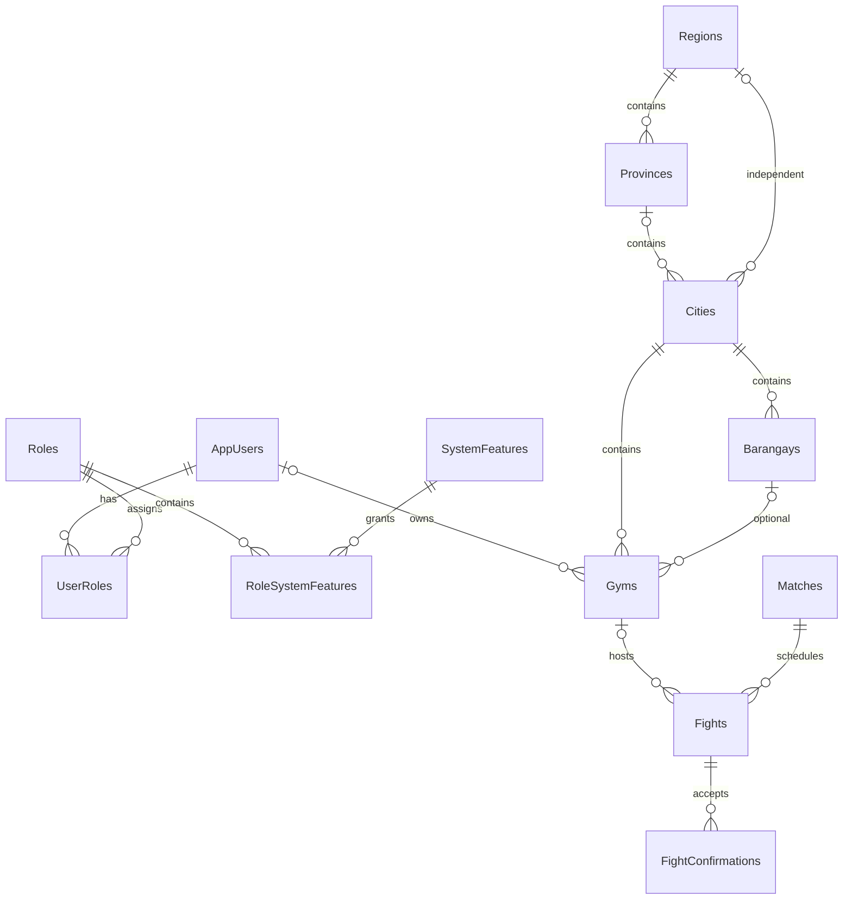

# Gym ownership and fight booking

Status: implemented and locally verified. Updated:
2026-11-07 (Asia/Manila). Owning scope: frontend/backend. This guide owns the
owner-approved gym marketplace MVP; rankings/results/payments remain deferred.

## Purpose and user flow

Anonymous visitors browse /gyms, /gyms/:id and /map. Owners sign up, create
multiple gym drafts, add a cover/public contact/address/pin/price/duration,
and publish directly. Fighters sign up, edit profiles, mutually match and
chat through REST. Their arrangement form offers a private location or a
published gym. Gym requests need owner approval, then both participant waivers.
The owner records completion after the reserved session ends. Public completed
history is anonymous unless both fighters consent to showing names/avatars.
Consent can be withdrawn after completion. Private arrangements never appear.

## Models, relationships and source

Active backend paths below are relative to ACTIVE_backend_lalamog.
`Models/Gym.cs` replaces Map with preserved IDs. Fields: OwnerUserId (nullable
only for unclaimed legacy imports), Slug, Name, Description, ContactInformation,
Address, Latitude/Longitude, CityId, optional BarangayId, SessionPrice decimal
(10,2), SessionDurationMinutes (30–240, default 60), IsPublished, IsDemo and
rowversion Version. Prices are PHP per pair; settlement happens at the gym.
Publication requires an assigned owner with owner_canManageGyms. Existing explicit geography remains;
no recursive area model or artificial many-to-many entity was introduced.

Fight retains its match/confirmations and gains nullable GymId, QuotedPrice and
SessionDurationMinutes. Private fights have no GymId; gym fights store shared
venue facts only on Gym, enforced by the existing SQL check. Booking price and
duration are snapshots rather than copies of mutable current offers.
FightConfirmation.AllowPublicIdentity defaults false and is independent of
waiver acceptance. No winner, score or payment transaction is stored.

Source: Controllers/GymsController.cs, AdminGymsController.cs, FightsController.cs,
AuthController.cs and AccessController.cs; Services/GymService.cs, FightService.cs,
AuthService.cs, AccessService.cs; domain repositories/interfaces; DTOs/GymRequest,
GymResponse, GymBookingResponse, PublicFightResponse and participant contracts.
Web: src/Gyms.tsx, OwnerGyms.tsx, Admin.tsx, Fights.tsx, FightMap.tsx, App.tsx,
LocationPicker.tsx, types.ts and existing shared styles/UI.

## Role and HTTP contracts

Roles contain permissions; current SQL grant unions authorize operations.
Custom containers work without special role-name checks. Anonymous gym reads
use VISITOR's visitor_canViewGyms permission; private policies require a login.
See [role permissions](ROLE_PERMISSIONS.md) for defaults and assignment rules.

Role keys: ADMIN, FIGHTER, GYM_OWNER and anonymous VISITOR. Signup accountType is fighter (default)
or gymOwner; all other choices fail. Accounts without user_canMatch are excluded from
discovery and direct swipe targets, regardless of role name. POST /api/auth/enable-fighter lets an
account with owner_canEnableFighter add only FIGHTER. Auth responses and /auth/me return current
roles/permissions queried from SQL, not permission claims in a stale cookie.
Admin accounts are not available through signup. Existing feature policies
remain; new owner_canManageGyms and owner_canManageBookings protect ownership
operations. Resource ownership/participant checks still apply to every write.

| Route | Access and behavior |
| --- | --- |
| GET /api/gyms | Anonymous published listings with valid owners; no fight history in list |
| GET /api/gyms/{id} | Anonymous published details and latest 100 completed public summaries; owner/booking participants may read unpublished venue details |
| GET /api/gyms/{id}/cover | Same visibility rules; streams image, no-store/nosniff |
| GET /api/gyms/mine | Owner gym list, including drafts |
| POST /api/gyms; PUT /api/gyms/{id} | Owner creates/updates own gym; update requires current base64 Version |
| POST /api/gyms/{id}/publish or /unpublish | Owner listing controls; unpublishing prevents new requests but retains bookings/history |
| POST /api/gyms/{id}/cover | Owner-only validated multipart cover upload, max 5 MiB decoded format checks and 6 MiB request envelope |
| GET /api/gyms/bookings | Owner-specific latest 100 bookings with fighter names, quote, time, status and confirmation count; no contacts or waiver content |
| POST /api/gyms/bookings/{id}/approve, /decline, /cancel, /complete | Owning gym owner; decline/cancel require reason |
| POST /api/fights | Participant; matchId/scheduledAt plus either private location/address/mapLocation or gymId/gymVersion |
| POST /api/fights/{id}/publication | Participant with own saved confirmation; allowPublicIdentity can change after completion |
| GET /api/access/users; existing access role endpoints | Admin-safe display names/IDs/role choices; no email/password/private profile fields |
| GET /api/admin/gyms; POST /{id}/unpublish; POST /{id}/owner | Admin listing moderation and assignment of unclaimed venues to an account with owner_canManageGyms; no participant waiver override |

Public DTOs exclude account email, participant IDs, waiver/contact fields,
match IDs and cancellation text. Names/derived avatar URLs are included only
when both confirmations allow publication. Public contact information is a
separate owner-entered business field. Missing/inaccessible resources yield
404, absent permissions 401/403, invalid fields 400, stale quotes/versions,
capacity conflicts or invalid transitions 409. All mutations preserve CSRF.

## State, concurrency and privacy invariants

| Action | Transition / rule |
| --- | --- |
| Private proposal | scheduled; existing participant/time/manual venue validation |
| Gym request | pending_approval; published valid owner; matching current GymVersion; future UTC instant |
| Owner approval | pending_approval → scheduled; future start and no overlapping approved booking |
| Waiver | scheduled → confirmed after both participant acceptances; pending requests cannot accept waivers |
| Decline/cancel | unfinished → canceled; nonblank private reason; releases the slot |
| Gym completion | confirmed → completed; owner only, two confirmations, session end reached |
| Private completion | existing participant completion after scheduled time |

The filtered unique match index now includes pending_approval. Approval runs
inside the existing serializable retry operation and checks half-open session
intervals; adjacent sessions are permitted, overlapping approved sessions are
not. Index (GymId,ScheduledAt) supports the query. Pending requests do not
reserve gym capacity. Rowversion protects concurrent edits. Expired requests
cannot be approved; explicit cancellation clears unfinished requests. No worker
or automatic expiry is claimed. Location edits are blocked while any unfinished
booking exists. Price/duration edits affect new requests only. Admin cannot
accept a participant waiver or read contacts through owner/public projections.

## Media and startup

Reuse IFileStorage validation plus SetGymCoverAsync and derived private Blob key
`gyms/{gymId}/cover`. No image URL/key/bytes are stored in SQL. Local replacement
is atomic; Blob replacement preserves the old object on failed uploads. The
public generic /api/media catch-all refuses gym paths, preventing draft cover
visibility bypass. Missing images use a frontend placeholder. See [media](MEDIA_STORAGE.md).
No new configuration provider/infrastructure was added. SQL/Azurite remain
existing services. Program registrations/configuration remain inline; static
DatabaseSeeder is still the single fictional-data owner. REST chat remains
three-second active refresh; owner/admin pages use explicit Refresh controls.

## Migration, seed data and recovery

20261107080243_GymBookingMvp renames Maps → Gyms and Fight.MapId → GymId,
retains keys/geographic indexes/FKs, adds metadata/consent fields and expands
status/index checks. Existing User role becomes Fighter without changing its
ID, assignments or custom grants. Existing publication consent is false.
The subsequent PermissionContainers migration standardizes FIGHTER/ADMIN/GYM_OWNER
without changing IDs/grants; VISITOR has no account assignment.
Unclaimed imported venues remain unpublished until an admin assigns an owner.
Default role/feature setup and demos remain in DatabaseSeeder, not duplicated
in migration callbacks. Non-Development deployment needs explicit migrations
and role/feature provisioning; no production demo seeding is implied.

Down refuses owned gym or pending-request data rather than silently discard it;
use a matching verified backup for a real rollback. Earlier migration history
is retained. Source/media/schema upgrades must be recovered together.

Fresh development seed: 22 fictional users/profiles, four roles, 13 feature
codes, 20 grants, 23 user-role links, three gyms, five matches, ten fights and
17 confirmations. Original 21 fighter accounts remain; owner.seed@example.test
owns the three known gym pins. All demo passwords: Lalamog123!Test. Existing
passwords, changed grants, gym edits, unpublishing and fight statuses survive
reruns. A past confirmed booking at Demo Antipolo Gym 3 lets the owner demonstrate
completion immediately; new bookings retain production time checks.

## Demo walkthrough

1. Open /gyms anonymously; browse details/map and sign in through /login.
2. owner.seed@example.test → My gyms: edit a gym, upload a cover, publish and
   review requests. Or register a new Gym Owner and create a listing from scratch.
3. Use two new Fighter accounts, edit profiles, mutually Like, open Inbox and
   chat. From Start the Match choose Registered gym, review PHP price/duration,
   choose a future local time and request it.
4. Owner Refresh → Approve. Both fighters Refresh their fights, submit separate
   waivers/contacts and optionally consent to public names.
5. Owner completes after session end. For immediate manual completion use the
   seeded past confirmed booking; automated SQL tests use the injected clock.
6. Browse completed public history, withdraw one consent and reload to see
   anonymous history. Also exercise private proposal/cancel and owner decline.
7. alex.seed@example.test is the seeded admin: role assignment/unpublish and
   unclaimed legacy gym assignment are available in Admin.

## Acceptance, latest work and limits

Latest work: 2026-11-07 owner-approved MVP completed. Final backend regression:
80 passed, zero skipped (3m41s), including real SQL/Azurite, populated preserving
migration, overlap concurrency, seed edit/grant preservation and private/public
boundaries. Frontend production build passed; EF reports no pending model
changes. Browser main suite: 18 passed (2m30s), covering the real new owner/two
fighter flow plus existing map/design cases; one additional real owner/admin
controls case passed (45s), for 19 browser checks total. Consent withdrawal
waits for server acknowledgment. Public and owner layouts at 360/375/390/1440px
had no horizontal overflow; 375/1440px public views and owner mobile/editor
screenshots were visually reviewed.

Normal app is healthy at localhost:5080 with Vite at localhost:5173. SQL session
metadata confirms it uses Lalamog. Anonymous gym browsing, seed-owner login,
three owned gyms, owner-only role, privacy-safe booking DTOs and cookie/CSRF/
logout through the same-origin proxy passed. Four published gyms currently
include the user-retained accidental demo listing. The five generated demo
accounts are retained as explicitly requested. A second verified backup
preceded final normal startup; the earlier initial-upgrade incident remains
accurately recorded below.

Tests: GymBookingTests.cs, GymMvpMigrationTests.cs, GymCoverTests.cs, updated
startup/seeder/access/legacy migration cases and frontend gym-booking.spec.ts.
Normal app media/cloud deployment, physical-device GPS and SQL container restart
were not rerun; no production deployment is claimed. No required MVP work
remains. Living contracts/related guides and current handoff are synchronized.

The real-browser demo uses a generated LalamogTests_GymBrowser_<guid> database
and separate Blob container. Explicit opt-in variables: LALAMOG_GYM_TEST_DATABASE,
LALAMOG_GYM_API_PID and LALAMOG_WEB_URL. Before signup it verifies the API process's
actual SQL session uses that database. Its time-fixture changes only the selected
fight in that generated database; sqlcmd -I is required for filtered indexes.
No application time-bypass endpoint exists.

An initial launcher used PowerShell's dictionary adapter instead of explicit
DbConnectionStringBuilder setters and incorrectly selected normal Lalamog.
The preserving migration applied and five fictional accounts/two gym listings/
one match/one fight were added there. The process was stopped; a COPY_ONLY/
CHECKSUM backup was verified after discovery. Automatic cleanup review rejected
deleting normal rows, and the owner explicitly chose to retain these additions.
They were not removed. Corrected startup uses set_ConnectionString/Add/
get_ConnectionString plus SQL-session preflight. Never claim this task's backup
preceded that first normal upgrade. No volumes or original accounts were reset.

Cloud deployment, payments, rankings/results, notification workers, multiple
simultaneous spaces and richer availability calendars remain outside this MVP.
