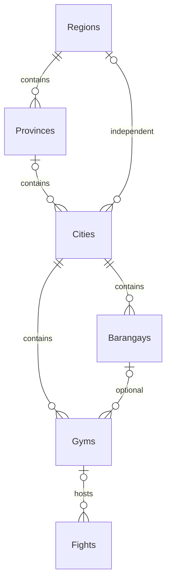

# Maps, Azure address lookup and Philippine areas

2026-11-07 permission-container update: Public gym reads use visitor_canViewGyms: anonymous requests check the reserved VISITOR container; authenticated requests check their assigned-role union. Published-owner eligibility uses owner_canManageGyms, regardless of role title. Reverse lookup remains authenticated user_canMap. See [role permissions](ROLE_PERMISSIONS.md).

2026-11-07 current: Gym Booking MVP supersedes the earlier Map venue name and admin publication API: Gym/Gyms and Fight.GymId preserve all existing venue IDs and geography. Anonymous /api/gyms and public /gyms/:id and /map show registered venues; owner APIs manage listings/requests. /api/maps retains only protected reverse lookup. Explicit geographic models remain unchanged. Current contracts/privacy/model and checks: [gym booking](GYM_BOOKING.md). Earlier Map/MapId source paths and routes below are historical.

## Public gym venues and explicit geography

Active geography models are MapRegion, MapProvince, MapCity and MapBarangay;
tables are Regions, Provinces, Cities and Barangays. Each has an integer ID,
unique PSGC Code and Name. No active entity has a self-reference, generic parent
or persisted Level discriminator. Gyms replaced the old Maps venue table.

A city has exactly one ProvinceId or independent RegionId. Gym.CityId is required;
optional (BarangayId,CityId) FK ensures a verified barangay belongs to that city.
Dependent deletion is restricted. These named joins support future geographic
queries; ranking outcomes and fighter representative areas remain unimplemented.
Private profile pins are not silently used as public ranking areas.

Source: Models/MapRegion.cs, MapProvince.cs, MapCity.cs, MapBarangay.cs, Gym.cs,
Fight.cs; Data/AppDbContext.cs and DatabaseSeeder.cs; GymService/GymRepository and
their interfaces. PSGC reference JSON may retain source ancestry; it is not an
EF recursive entity. Manila submunicipalities are flattened to their city.
MapAreaResponse is only a flat breadcrumb. GymRequest.areaCode accepts a city or
barangay code and resolves named IDs. Avatar/profile privacy remains unchanged.

### Public routes and privacy

The public map uses GET /api/gyms and /api/gyms/{id}, guarded by
visitor_canViewGyms (VISITOR for anonymous, own role union when signed in).
Owners manage their venues and booking decisions under /api/gyms; admin moderation
is under /api/admin/gyms. Public completed histories exclude match/participant
IDs, contacts, waivers and cancellation text; public names/avatars require both
fighter consents. Private fight pins remain participant-only. Full source,
contracts and demo: [gym booking](GYM_BOOKING.md),
[permission containers](ROLE_PERMISSIONS.md).

The old GET/POST /api/maps and admin venue scheduling routes are retired.
POST /api/maps/reverse remains protected by user_canMap, authentication and CSRF.
Explicit address lookup, OSM attribution, local selectors and manual fallback
remain intact. Gym location changes are blocked while unfinished bookings exist.

### Migration and verification

PublicGymMaps is historical evidence for the initial recursive schema.
ExplicitMapGeography copied names/codes into typed tables, preserved venue IDs
and pins and refused unknown ancestry instead of guessing. GymBookingMvp renamed
Maps/Fight.MapId to Gyms/GymId in place, preserving links. Back up and verify
before normal upgrades; do not recreate old models or delete migration history.
Current startup uses inline MigrateAsync then static DatabaseSeeder.SeedAsync.

2026-11-07 application checks: 85 backend cases passed, frontend build/model
checks passed, and 20 permission/map/layout plus two isolated booking browser
cases passed. Prior 79/80-case geography records were historical intermediate
runs. Physical GPS, distance filtering, ranking and deployment remain unverified
or deferred; listing moderation is implemented. Latest operations: [handoff](../memory/HANDOFF.md).

## Legacy provider audit and registration links

| Unchanged legacy source | Provider / purpose | Active choice |
| --- | --- | --- |
| `LEGACY_frontend_lalamog/Components/InteractiveMapPicker.tsx` and `Components/PublicFightsMap.tsx` | [Leaflet](https://leafletjs.com/) CDN; [OpenStreetMap tiles](https://operations.osmfoundation.org/policies/tiles/) | npm Leaflet 1.9.4, bundled CSS; OSM interactive tiles, no key |
| `LEGACY_frontend_lalamog/app/(tabs)/messages/matchSettings.tsx` and `lib/fetchProfilesCopy.ts` | [Nominatim](https://nominatim.org/) reverse lookup | Historical reverse provider; active address suggestions use Azure Maps |
| No authoritative barangay catalog/boundary dataset found in inspected legacy flows | Geocoder road/suburb/city labels were not official barangay IDs | Local [PSA PSGC](https://psa.gov.ph/classification/psgc/) snapshot |

No keyed map provider was found in those legacy flows. The active reverse provider now requires an Azure Maps account/key; maps and local area selectors work without that key. Optional future PSA API registration: official [access form](https://psa.gov.ph/classifications-api/request-access-form) and [PSGC API documentation](https://psa.gov.ph/classifications-api/psgc). The application does not call that API or need a token.

Policies checked 2026-11-02: OSM requires visible attribution, HTTPS `tile.openstreetmap.org/{z}/{x}/{y}.png`, normal browser Referer/cache headers, no bulk/offline prefetch; availability is best effort and this setup is for modest interactive use. Tests intercept tiles. Historical Nominatim constraints (the active code no longer calls it): public [Nominatim policy](https://operations.osmfoundation.org/policies/nominatim/) requires app-wide throttling/caching and restricts autocomplete, systematic/confidential lookups. Do not restore legacy fan-out calls. Owner deliberately approved this specific lookup; no discovery-card/bulk/autocomplete requests.

## Reference data and provenance

`Data/Reference/psgc-2026-q3.json` is reference **data**, not configuration or an EF seed helper. It is copied on build/publish and loaded once by `AreaService`. No runtime upstream catalog calls or additional startup settings. Its DI registration remains inline in Program.cs: `AddSingleton<IAreaService, AreaService>()`.

- PSA Q3 2026, as of 2026-09-30: 18 regions including NIR, 82 provinces, 149 cities + 1,493 municipalities, 42,010 barangays. Fourteen Manila submunicipalities remain internal ancestry nodes; city endpoint returns 1,642 cities/municipalities.
- Official [workbook](https://psa.gov.ph/system/files/scd/PSGC-3Q-2026-Publication-Datafile.xlsx) returned HTTP 403 during import. Public [workbook mirror](https://raw.githubusercontent.com/rbillyjames0221/psgc-api/main/seed/PSGC-3Q-2026-Publication-Datafile.xlsx) supplied the file; metadata identifies PSA as originator and requires acknowledgement. Official published counts/hierarchy were cross-checked; no PSA checksum independently authenticates the mirror.
- JSON metadata records version, official URLs, actual retrieval URL/date, workbook SHA-256 and PSA attribution. Worksheet PSGC code/name/geographic level/city class supplied the hierarchy. Codes are exact ten-character strings preserving leading zeros; every parent exists.
- HUC/ICC cities belong directly to regions; NCR has no provinces. Provincial cities/municipalities belong to provinces. Manila barangays traverse submunicipality ancestors. Duplicate names remain distinct by code.
- [PSGC Cloud](https://psgc.cloud/) and `psgc.gitlab.io/api/` inspected but not adopted: both region feeds returned 17 regions without NIR. Do not replace this snapshot with an older feed.

Refresh deliberately: verify the next PSA release's terms/counts/codes/ancestry/exceptions; retain old snapshot in Git and define saved-code compatibility before changing version. Never overwrite user data or assume renamed/split areas are aliases. Saved rows retain source version; rollback catalog/code together.

## Source map and API

- `Controllers/AreasController.cs`, `Interfaces/IAreaService.cs`, `Services/AreaService.cs`; reference-only `Models/AreaCatalog.cs` and `PhilippineArea.cs` are not DbSets. Anonymous lookup returns `{ code, name }[]`, cacheable for one day.
- GET `/api/areas/regions`; `/provinces?regionCode=...`; `/cities?regionCode=...&provinceCode=...`; `/barangays?cityCode=...`. Omitted province means all cities in region; `provinceCode=none` means independent cities. Invalid ancestry returns 400.
- Private data: `DTOs/MapLocation.cs`, profile/schedule/fight DTOs, `FighterProfile`, `Fight`, `ProfileService`, `FightService`, `DtoMapper`, `AppDbContext`.
- Web `LocationPicker.tsx`: cascading region → province/independent city → city/municipality → locally filtered barangay; reset children when parents change. `LocationMap.tsx`: click/drag pin, tile-error/manual fallback, visible attribution, cleanup. GPS only on explicit action with denied/timeout fallback; coordinate inputs remain usable.
- `ProfileEditor.tsx` and `Fights.tsx` accept structured areas and optional pins. `FightMap.tsx` combines shared gym API pins/details with participant-authorized private pins, private status filtering and arrangement links. It displays no emergency contacts.

## Privacy, migration and compatibility

Nested `mapLocation`: nullable `regionCode`, `provinceCode`, `cityCode`, `barangayCode`, `psgcVersion`, `latitude`, `longitude`. Paired finite WGS84 latitude/longitude with ranges ±90/±180; 0,0 valid. A structured selection requires region/city/barangay and matching optional province. Coordinates may be used without areas; no point-in-boundary verification.

Own profile GET/update/avatar responses include private mapLocation. Discovery/match-opponent responses omit the field entirely. A structured selection makes public location the canonical city name; exact profile barangay/pin remain private. Omitted/null update mapLocation preserves existing data for old clients; `{}` clears it. Session pins remain participant-only through existing authorized fight routes; name/address remain editable text. Explicit lookup sends the selected public-place coordinates to Azure Maps; it never runs automatically on GPS/pin movement or profile browsing.

`Migrations/20261102074948_PhilippineMapLocations.cs`: fourteen nullable columns plus two SQL pair/range checks across profiles/fights. Existing text/rows preserved; old fights remain unpinned. Verified COPY_ONLY/CHECKSUM backup preceded local Lalamog migration; private backup path is in ignored `.cache/map-backup.json`. Development startup invokes MigrateAsync then static DatabaseSeeder.SeedAsync inline in Program.cs (owner revision 2026-11-04). Other environments use explicit migrations. This original migration seeded no venue pins; the later PublicGymMaps slice above adds three explicitly fictional shared gym pins.

## Azure Maps suggested address lookup (owner revision, 2026-11-07)

Source: `Controllers/MapsController.cs`, `Interfaces/IReverseGeocodingService.cs`, `Services/ReverseGeocodingService.cs`, `DTOs/ReverseGeocodeRequest.cs`, `ReverseGeocodeResponse.cs`; web `LocationPicker.tsx`, `types.ts`, `styles.css`. No SQL/model/migration or package change.

Choose a public-place pin, explicitly press **Find address for this pin**, review the suggestion and expandable **View address details**, then **Use this address** in a venue form. Address text remains editable and saves through the existing scheduling endpoint. Copying truncates at the existing 300-character venue limit with a notice. Profile suggestions are view-only; they do not replace public city text, select PSGC codes or save additional private fields. Pin changes/unmount cancel obsolete requests and clear suggestions. GPS, typing, page load and pin movement never trigger lookups. The notice names Azure Maps; OSM attribution remains on the unchanged map tiles.

### HTTP contract and complete provider details

POST `/api/maps/reverse`, cookie + User.Map permission + normal CSRF, JSON `{ latitude, longitude }`, required finite WGS84 pair. Cache-Control is no-store. Compatible fields remain `address`, `road`, `suburb`, `city`, `state`, `country`. Added: `provider` (Azure Maps), nullable `streetNumber`, `postalCode`, `countryCode`, `resultType`, `confidence`, string-array `matchCodes`, and `features` containing every complete Azure GeoJSON feature. Nested address parts, all administrative subdivisions, intersection information, IDs, bounding boxes, geometry, display/route points, calculation methods and any extra returned fields are retained rather than discarded. Availability depends on Azure data; absent values are not invented.

`address` prefers Azure formattedAddress. Sparse results fall back to available street number/name or addressLine, neighborhood, locality, administrative areas, postcode and country. `road` maps streetName, `suburb` maps neighborhood, `city` maps locality, and compatibility `state` is the first named administrative subdivision. Do not assume state means Philippine province or neighborhood means official barangay. The native adminDistricts array preserves the hierarchy. No exact-address, official PSGC or point-in-boundary guarantee. Provider feature coordinates may differ from the requested pin; neither the pin nor PSGC selection is changed.

### Inline configuration, caching and failures

All setup stays directly inline in Program.cs. Named HttpClient `AzureMaps` targets `https://atlas.microsoft.com/`, eight-second timeout, English response language and server-only `subscription-key` header from `Maps:AzureMapsApiKey`. Existing owner settings are preserved; the old Maps:NominatimUrl setting is unused and there is no Nominatim fallback. Use built-in private configuration/environment overrides for deployed keys; never put keys in Vite variables, URLs, API responses, screenshots, documentation or logs. HTTP client loggers remain removed because upstream URLs include coordinates.

The service calls `reverseGeocode?api-version=2026-01-01&coordinates=longitude,latitude`, with no resultTypes restriction so Azure can return its most specific available entity. Original coordinate precision is retained instead of the previous five-decimal rounding. Every feature is cloned before disposing the provider JSON document. The existing process-wide gate conservatively limits upstream traffic to one request/second, deduplicates identical queued pins and uses a bounded 500-entry/day memory cache. Keys include provider/version and the exact requested coordinate pair. Empty results are cached; outages/invalid JSON/auth failures are not. Azure 429 and 503 with Retry-After establish a cooldown; there are no automatic retries, background calls or batches. This pacing is an application choice to limit usage, not an Azure service quota or spending cap. Caches/pacing are per API process and clear on restart.

400 invalid/missing coordinates or CSRF; 401 missing app authentication; 403 missing app permission; 404 no address; 429 local queue busy; 503 missing Azure configuration or provider error/timeout/auth/rate limit. Safe manual fallback text excludes keys, provider response bodies and coordinates. Missing key prevents all upstream calls. Azure's free allowance is limited and excess requests may be billed; the user's 2026-11-07 provider choice supersedes the earlier no-billing-account rule for reverse lookup only. No Azure account/resource or paid tier was created by this change.

Official API reference: [Azure reverse geocoding](https://learn.microsoft.com/en-us/rest/api/maps/search/get-reverse-geocoding?view=rest-maps-2026-01-01). Nearby POIs, routes, timezone and administrative polygons require separate APIs and are not added here. Azure address lookup does not replace Leaflet/OSM map rendering.

### Acceptance and recovery

`ReverseGeocodingTests.cs` covers full GeoJSON/unknown-field retention and disposed-document safety, longitude-first exact coordinates, header-only key, compatible/sparse address mapping, cache/dedup/pacing, cooldown, empty results, malformed/offline/timeout/auth errors, missing key, cancellation and invalid pairs. `GeocodingApiTests.cs` uses an isolated SQL test database and fixture-only Azure header to check actual named-client composition, cookie/CSRF/validation/no-store and key omission. Browser `tests/maps.spec.ts` uses intercepted Azure-shaped responses to check review/details, mobile/desktop overflow, editable save, independent PSGC, failed lookup and stale-response cancellation. Automated tests never call Azure.

Recovery: restore the service, response DTO, inline named client, web types/UI and provider fixtures together. Keep Maps:AzureMapsApiKey private and restart the API after rebuilding; clearing/restarting the process also clears its old cache. Manual text/catalog/map controls work during a provider outage. No database migration, volume reset, media change or legacy edit is required.

## Latest work record and verification

2026-11-07 / Azure Maps replacement: implemented at the owner's explicit request. The former adapter discarded all but five address parts; the new response retains complete Azure features plus compatible fields and match metadata. The configured key was verified with one deliberate public Rizal Park vicinity lookup; Azure returned one Address feature with street number/name, neighborhood, locality, postalCode and adminDistricts. The updated local API was restarted from the isolated verified build; health passed. A second public-place lookup through localhost:5173/api/maps/reverse, using a separate fictional demo cookie/CSRF session, returned Azure Maps with an Address/High result and complete features. The smoke session logged out; no profile/venue data was changed. No private coordinates or provider payload were written to documentation. Fresh verification: isolated .NET solution build and 18 provider/protected-API cases passed; 16 map privacy/catalog/service-composition cases passed (34 targeted backend checks total). Frontend TypeScript/Vite build and all six map browser cases passed. Mobile detail labels/values stack to prevent word splitting; the production rebuild and all six map fixtures passed again. Visual review also found that the pre-existing schedule fieldset rule squeezed the location picker into two nested columns on desktop; the picker now spans the form with a single outer column. The final production build and focused review/edit/save fixture passed with the desktop-width assertion; final 375/1440px screenshots were reviewed. The initial restricted restore failed to reach NuGet; the permitted rerun built successfully, with a cached NU1900 vulnerability-feed warning in the test project. No package versions were changed. Final knowledge validation passed (55 Markdown files, 506 local targets, 13 registered feature guides); git diff --check passed.

Earlier 2026-11-02 Nominatim implementation (historical, replaced): both builds, all 55 backend tests, six map browser fixtures and one public-place lookup passed. Earlier basic maps included populated-schema preservation, catalog ancestry/private profile/session checks and manual/GPS fallback. Current provider checks and limits must be recorded for this revision before completion.
Not run: full backend/avatar suite, full browser core/restart suite, live device GPS, provider quota/load testing or production deployment. Existing map privacy/persistence checks passed against generated local test databases. No additional required implementation remains for replacing the reverse provider.
